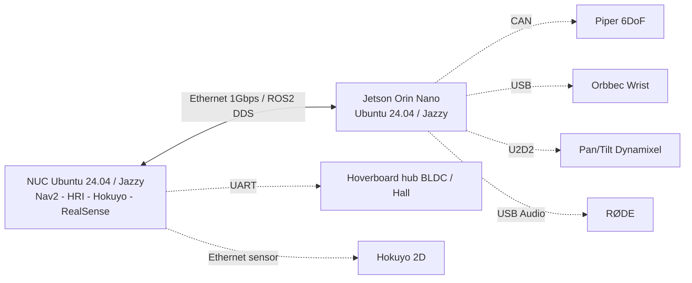

# Base@Home — Arquitectura física, potencia y cómputo (inventario a corroborar)

> **Edición integral v3 — 03/11/2026.** Esta documentación es una guía de trabajo, no prueba de ejecución en las máquinas. Los avances operativos se basan en los registros compartidos por el usuario (principalmente `HANDOFF.md`, 29–30/10/2026), deben cotejarse con el checkout y el estado de cada host. Política vigente: la navegación es **estudiable y auditable sin modificarla**; observaciones y propuestas se registran en `docs/collab/PROPUESTAS_NAVEGACION.md`. El estado de tareas en Orca/Git puede ser más reciente que estos documentos.

## Resumen documentado

Arquitectura distribuida **NUC ↔ Jetson Orin Nano** por cable Ethernet directo, CycloneDDS ROS 2. De acuerdo con HANDOFF 30/10/2026, conexión real Ethernet: NUC `enp1s0` ↔ adaptador USB RTL8153 de Jetson `enx00e04c68090c`, 1 Gb/s, con IPs `10.42.0.1` y `10.42.0.12`. El puerto integrado de Jetson no tenía carrier. Las IP/canal/driver **deben volver a verificarse** antes de cambio alguno.

**NUC:** Ubuntu 24.04 LTS / Jazzy, cómputo de navegación, LIDAR Hokuyo, RealSense D435, ROS 2/Nav2 y HRI. **Jetson:** migración reportada a JetPack 7.2.1, Ubuntu 24.04 / ROS 2 Jazzy; procesa Piper/CAN, Dynamixel pan-tilt, RØDE audio ASR y Orbbec DaBai de muñeca, según README/HANDOFF. Sin embargo, la asignación puede haber cambiado; verificar nodo/host real.

| Subsistema | Hardware informado | Host/medio | Estado que se debe verificar | Riesgos |
|---|---|---|---|---|
| Base móvil | 2 motores hub BLDC 6,5" de hoverboard, Hall | NUC + USB-TTL UART | navegación funcional; controlador y firmware por verificar | arranque incontrolado, drift, fallos de watchdog |
| Localización | Hokuyo UST-05LX LiDAR 2D | NUC + red sensor | nodo y tasas si necesario; **no reconfigurar** | pérdida de scan y seguridad navegación |
| RGB-D cabeza | Intel RealSense D435 | NUC USB | owner del driver/servicio | conflictos por doble apertura USB |
| Brazo | AgileX Piper 6DOF + gripper | Jetson CAN (según README) | modo disable, feedback reciente, potencia real | torque inesperado/colisión |
| Muñeca | Orbbec DaBai DC1 | Jetson USB | 20 Hz reportados en NUC | optical frames, sync RGB-D |
| Pan-tilt | 2 × ROBOTIS Dynamixel XL430 | Jetson U2D2 | `auto_torque=false`, energización por sesión | golpes / límites de actuadores |
| Audio | RØDE VideoMic GO II | Jetson USB audio | captura, VAD, Whisper | privacidad y latencia |
| Elevador | NEMA23 + mecanismo vertical | controlador por verificar | sin prueba física en registros | atrapamientos/colisión/vuelco |
| Brazo y torso | estructural, URDF/Xacro, pantalla expresiva | varios | geometría/masa a medir | colisión con Piper y estabilidad |

### Dominios energéticos — inventario pendiente de validación

Plan histórico del equipo: 7s6p para NUC/LiDAR; 10s3p para motores hoverboard; 7s5p para elevación + Jetson (mediante conversión); salida ~12 V para 2 Dynamixel. **No usar este texto como plano eléctrico validado.** Revisar BMS, fusibles por rama, calibre de cable, polaridad, corrientes máximas, protecciones, estado de masas y fuentes con el equipo responsable. Ningún agente debe ordenar conectar baterías en paralelo ni alimentar actuadores a partir de estas notas.

## Trabajo permitido de los agentes

- Documentar de forma exhaustiva cada dispositivo: fabricante/modelo, interfaz, dirección, bus, alimentación, start script, dependencia, ROS topic, feedback, límites, fallos y comandos de diagnóstico no invasivo.
- Cruzar README, código, servicio systemd, `udev`, `lsusb`, `lspci`, `ip -br addr`, `ros2 node/topic list` y logs saneados; separar observación física de declaración de documento.
- Analizar distribución de cómputo y proponer mejoras de utilización GPU, ROS QoS y mantenimiento, sin arrancar o resetear hardware.
- Crear diagramas de energía y comunicación Mermaid/Graphviz, inventarios y manuales de emergencia con evidencia y estado `NO VERIFICADO`.

## Mapa lógico de responsabilidad (propuesta a verificar)

Un diagrama no sustituye el esquemático de potencia, no indica que el hardware esté energizado ni garantiza que haya un enlace CAN disponible. Estado real por `HANDOFF.md`.
