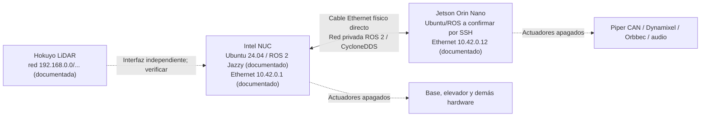

# Red Ethernet NUC ↔ Jetson — arquitectura, diagnóstico y pruebas de integración ROS 2

> Proyecto Base@Home / UruBots, actualización 2026-10-29. **Declarado por el usuario:** Intel NUC y NVIDIA Jetson Orin Nano están ENCENDIDAS, unidas directamente mediante un CABLE ETHERNET físico. Los demás subsistemas del robot están DESENERGIZADOS. Este documento es un protocolo de trabajo, **no una medición de la red real**.

## 1. Contexto innegociable

- **NUC:** host principal, Ubuntu 24.04 + ROS 2 Jazzy según README; navegación funciona. **No modificar Nav2, AMCL, SLAM, mapas, odometría, motores, control de base, footprint, costmaps ni sus launch/firmware.** Pueden inspeccionarse interfaces y comprobarse configuración de red sin alterarla.
- **Jetson Orin Nano:** host secundario encendido, posiblemente Ubuntu 22.04 + Humble según README histórico; confirmar estado en vivo por SSH. **Se autorizan diagnóstico, respaldo, mantenimiento de software y migración preparatoria a Ubuntu 24.04 + ROS 2 Jazzy.** Respetar el gate de borrado/UEFI-QSPI del documento de migración.
- **Periféricos y actuadores:** Piper, Dynamixel, elevador, motores y demás alimentaciones independientes **apagados**; no lanzar controladores que habiliten torque, auto-home, motores o buses activos. Que un dispositivo no responda no implica fallo si está desenergizado.
- **Cuentas y seguridad:** ROS 2 solamente; sin Google/Gmail/Drive/Calendar/cuentas ni datos personales, sin gastos y sin credenciales expuestas. Usar únicamente la red privada del robot y documentación técnica pública.

## 2. Topología inicial (documentada, NO validada en vivo)



El README público documenta **NUC: `10.42.0.1` interfaz `enp1s0`; Jetson: `10.42.0.12` interfaz `enP8p1s0`; red `10.42.0.0/24`; ROS_DOMAIN_ID `10`; CycloneDDS unicast con peers**, y documenta una **subred distinta para el Hokuyo (`192.168.0.10`)**. Estos nombres y direcciones pueden haber cambiado. *No tratar el enlace del LiDAR como la conexión física NUC↔Jetson sin inspeccionarlo.*

## 3. Tarea HOME-01E — diagnóstico no destructivo de ambos hosts

1. Desde la NUC, registrar estado de Git/worktree, hostname, SO, interfaces, rutas y vecinos **sin modificar red**:

   ```bash
   hostnamectl
   cat /etc/os-release
   ip -br address
   ip -br link
   ip route show
   ip neigh show
   nmcli -g GENERAL.DEVICE,GENERAL.STATE device show 2>/dev/null || true
   ```

2. Confirmar el cable Ethernet que efectivamente une a ambos equipos (NIC, `LOWER_UP`, IPv4, MTU y ruta de destino). Un enlace físico activo no garantiza IP en misma subred ni acceso SSH. Reconciliar `ip route get <IP_JETSON_CONFIRMADA>` con las interfaces visibles.
3. Solo después de verificar IP, realizar una **única** prueba de red (`ping -c 3 <IP_JETSON_CONFIRMADA>`) y conexión SSH usando usuario **preexistente y autorizado**. No inventar credenciales ni usar `StrictHostKeyChecking=no` ni `UserKnownHostsFile=/dev/null`:

   ```bash
   # Reemplazar usuario/IP exclusivamente por valores verificados.
   ssh -o ConnectTimeout=8 usuario_confirmado@IP_JETSON_CONFIRMADA
   ```

   Si SSH muestra una huella nueva, verificarla de forma independiente antes de aceptar; si cambia inesperadamente, detener y consultar. No intentar contraseñas aleatorias, ampliar permisos ni copiar claves.
4. En la Jetson, inspeccionar solamente en primer reconocimiento:

   ```bash
   hostnamectl
   cat /etc/os-release
   cat /etc/nv_tegra_release 2>/dev/null || true
   uname -a
   ip -br address
   ip route show
   lsblk -o NAME,SIZE,FSTYPE,MOUNTPOINTS,MODEL
   df -h
   printenv ROS_DISTRO ROS_DOMAIN_ID RMW_IMPLEMENTATION CYCLONEDDS_URI
   command -v ros2 || true
   timedatectl status
   ```

5. Confirmar versiones reales de ROS 2 por host, `ros2 pkg list` y servicios systemd relevantes en modo lectura (`systemctl list-units --type=service --state=running`, `systemctl cat servicio_verificado`). Los servicios pueden autoarrancar con el host aunque los actuadores estén sin tensión: **no reiniciarlos ni modificarlos sin verificar efectos secundarios**.
6. Comparar `~/cyclonedds.xml`, RMW, peers, `ROS_DOMAIN_ID`, variables de entorno y hosts/hostname en ambos extremos; copiar a documentación **solo la configuración no secreta**. No volcar `.env`, tokens, llaves SSH ni historiales personales.
7. Verificar reloj: `date -Ins`, `timedatectl`, `chronyc tracking` si existe. Un reloj mal sincronizado produce TF/timeouts inválidos; documentarlo sin modificar NTP hasta entender su configuración.

## 4. Diagnóstico y validación ROS 2 sobre Ethernet

- **Antes de migrar:** Humble (Jetson) ↔ Jazzy (NUC) podría mostrar incompatibilidades de mensajes, QoS, parámetros o versiones de RMW. No asegurar interoperabilidad completa por descubrir tópicos.
- **Después de migrar:** alinear Ubuntu 24.04, ROS 2 Jazzy y RMW/CycloneDDS; definir dominio real `10` según configuración confirmada, pero usar **dominio de prueba aislado** para nodos sintéticos. Elegir un ID distinto que no esté en uso y verificarlo primero. No publicar en tópicos físicos ni activar servicios de actuadores.
- Probar: conectividad IP, SSH, latencia y pérdida de paquetes, DNS/hostname si se usa, QoS, DDS discovery, sincronización horaria y recepción de un mensaje **sintético** entre hosts en dominio de prueba.
- Los dos agentes pueden escribir una utilidad de prueba ROS 2 aislada que publique un `std_msgs/msg/String` en `/test/eth_link_status` **solo en un dominio de laboratorio separado de 10**, siempre tras comprobar que no hay otros procesos importantes en dicho dominio. Sin conectar a drivers físicos ni controlar nada.
- Registrar interface, IP, ROS distro, RMW, domain de prueba, comando exacto, hostname de origen/destino, porcentaje de paquetes, logs de discovery, timestamp, resultado y rollback. Nunca inventar resultados.

## 5. Evitar dejar la Jetson inaccesible

- No tocar IP, DHCP/NetworkManager, MTU, firewall, SSH, ruta por defecto, archivo CycloneDDS ni reboot mientras una operación depende de esa misma conexión sin plan de recuperación y una vía física de consola conocida.
- Antes de `apt upgrade`, `sudo`, reinicios o cambios de paquete que involucren red/kernel: evaluar impacto, guardar estado y contar con backup y acceso alternativo. Instalaciones de software aisladas y reversibles están permitidas; **el flasheo/borrado de unidades exige confirmación humana específica**.
- No permitir que dos agentes hagan instalaciones o reinicios a la vez sobre NUC/Jetson. Reservar `HOST_JETSON_OS` mediante Orca y anotar quién posee la tarea.
- No modificar software del NUC ni Nav2 como parte de un diagnóstico o migración de la Jetson.

## 6. Entregables de esta tarea

- `docs/network-topology.md`: diagrama confirmado, nombres de NIC, IP, rutas, hosts, protocolos, puertos y QoS sin secretos.
- `docs/ros-interfaces.md`: matriz de tópicos/servicios/actions entre NUC/Jetson, responsable, tipo y tasas medidas.
- `docs/jetson-inventory.md`: evidencia de SO, L4T/UEFI, ROS 2, almacenamiento, paquetes y servicios, diferenciar confirmados vs pendientes.
- Plan de pruebas interhost sin actuadores; logs y resultados sin credenciales ni información personal.
- `docs/collab/HANDOFF.md` actualizado por el integrador y tarea HOME-01E en Orca (si el módulo está habilitado).

## Fuentes

- README del robot: https://github.com/ShiiSuii/base_athome#1-system-architecture--distributed-computing
- Cyclone DDS configuración: https://cyclonedds.io/docs/cyclonedds/latest/config/index.html
- ROS 2 Jazzy redes: https://docs.ros.org/en/jazzy/Concepts/Intermediate/About-Domain-ID.html
- ROS 2 Jazzy configuración RMW: https://docs.ros.org/en/jazzy/How-To-Guides/Working-with-multiple-RMW-implementations.html
- Ubuntu Netplan: https://netplan.readthedocs.io/en/stable/
- NVIDIA Orin Nano quick start: https://docs.nvidia.com/jetson/orin-nano-devkit/user-guide/quick_start.html
- Tarea de migración: `docs/MIGRACION_JETSON.md`.
