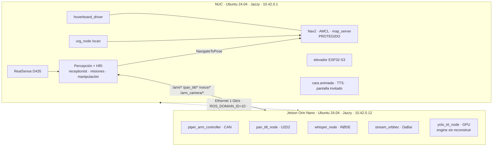

# ROBOT.md — Conocimiento técnico de Base@Home

Documento maestro de **arquitectura, hardware, software, navegación, calibraciones y simulación**.
Cambios de arquitectura → se actualizan aquí (ver política en `AGENTS.md` §9).

**Etiquetas de evidencia** (definidas en `AGENTS.md` §8):
`VERIFICADO 2026-11-03` = observado por comando en vivo en esa fecha ·
`CODIGO` = leído en el código del repo · `HISTORICO <fecha>` = medido en esa fecha, no revalidado ·
`FABRICANTE` = ficha pública · `PENDIENTE` = sin evidencia, no inventar.

---

## 1. Visión general

Robot de servicio doméstico para **RoboCup@Home OPL** (UruBots). Base diferencial con motores de
hoverboard, columna con elevador, brazo AgileX Piper 6-DOF con cámara de muñeca, cabeza pan-tilt
con RealSense D435, micrófono direccional RØDE, pantalla facial y parlante.

Dos computadoras unidas por **Ethernet directo** con ROS 2 Jazzy + CycloneDDS:

**Criterios de asignación de cómputo** (decisión 2026-10-30):
1. Cada nodo corre en el host donde está conectado su periférico (no viajan datos crudos ni comandos de bajo nivel).
2. La inferencia pesada va a la GPU de la Jetson si la entrada ya está allí.
3. La NUC queda para navegación, lógica de pruebas, UI y percepción de la cabeza.

| Función | Host | Motivo |
|---|---|---|
| Nav2, AMCL, `/scan`, odometría | NUC | sensores y base en la NUC; protegido |
| RealSense + HRI (rostros, personas, receptionist, máquinas de estado) | NUC | cámara en la NUC; necesita Nav2 y UI |
| TTS, pantalla, GUI, elevador, parser GPSR, editor URDF | NUC | hardware/herramientas locales |
| Piper (control 50 Hz), pan-tilt | Jetson | CAN y U2D2 en la Jetson |
| Cámara de muñeca + YOLO TensorRT → `/arm_camera/detections` | Jetson | solo viajan cajas, no imágenes |
| ASR Whisper | Jetson | micrófono en la Jetson; libera CPU de la NUC |
| Futuro: MoveIt con `agx_arm_ros` | NUC o Jetson | ambos en Jazzy; decidir midiendo |

## 2. Cómputo y sistema operativo

| | NUC (CHUWI LarkBox S) | Jetson Orin Nano Dev Kit **Super** (8 GB) |
|---|---|---|
| SO | Ubuntu 24.04.3, kernel 7.0 — `VERIFICADO 2026-11-03` | Ubuntu 24.04.4, L4T **R39.2.1** (JetPack 7.2.1), kernel 6.8.12-tegra — `VERIFICADO 2026-11-03` |
| ROS 2 | Jazzy, `rmw_cyclonedds_cpp`, `CYCLONEDDS_URI=~/cyclonedds.xml`, dominio 10 — `VERIFICADO` | Jazzy (`/opt/ros/jazzy`) — `VERIFICADO` |
| CPU / RAM | i3-1220P 10C/12T, 15 GiB, NVMe 468 GB | 6× A78AE; modo **25W** (CPU 1,344 GHz de 1,728) — `VERIFICADO`; 7,4 GiB compartida |
| GPU | Intel UHD (sin CUDA) | Ampere; CUDA 13.2, TensorRT 10.16 (`FABRICANTE` JP 7.2.1) |
| Almacenamiento | NVMe | **microSD** (flasheada 2026-10-30). NVMe recomendado para robustez |
| Entornos Python | `~/ros2_vision_venv` (percepción/HRI) | `~/robot_venv`; workspace `~/athome_ws` (**no es repo Git**, se despliega desde `jetson_head/`) |
| Servicios | `realsense-nuc.service` **no instalado** (`VERIFICADO`) | `jetson-head.service` (sistema) **activo** y `jetson-performance` (`jetson_clocks`) — `VERIFICADO` |

**Jetson migrada** el 2026-10-30 desde JetPack 6.2.3/Humble: flasheo por USB-C en recovery desde la
NUC (`jetson_head/scripts/flash_jetson_r39.sh`, microSD + QSPI), luego `bootstrap_jazzy.sh`
(Jazzy, venv, `gs_usb` compilado para 6.8, udev, red). **No se vuelve a migrar.** Ver §11 para recuperación.

**Riesgo `numpy`/`cv2`:** un export de Ultralytics instaló numpy 2 en `~/ros2_vision_venv` y rompió
`cv2` (revertido). No exportar modelos con ese venv; usar `YOLO_OFFLINE=1`.

## 3. Red y ROS 2 distribuido

| Host | Interfaz | Dirección | Estado |
|---|---|---|---|
| NUC | `enp1s0` (PCI) | `10.42.0.1/24`, NetworkManager "shared" (DHCP/NAT para la Jetson) | UP — `VERIFICADO 2026-11-03` |
| Jetson | `enx00e04c68090c` (adaptador **USB RTL8153**, `r8152`) | `10.42.0.12/24` fija (conexión `robot-nuc`) | UP — `VERIFICADO 2026-11-03` |
| Jetson | `enP8p1s0` (integrado) | — | DOWN, sin carrier desde 2026-10-29 (puerto o cable sospechoso) |
| NUC | `enx00e04c68060b` (USB) | `192.168.0.14/29` → Hokuyo `192.168.0.10` | red del LiDAR, independiente |

- Mediciones `HISTORICO 2026-10-30`: 1 Gb/s full, RTT 0,2 ms, ≥660 Mb/s por SSH, desfase de reloj −11,9 ms (NTP).
  La cámara de muñeca cruda ocupa ~150 Mb/s; no enviar RGB-D crudo de la D435 por la red (comprimir o procesar en origen).
- **CycloneDDS:** unicast, multicast desactivado, peers `10.42.0.1` y `10.42.0.12`. La Jetson liga por
  `address=10.42.0.12` (copia de referencia `jetson_head/config/cyclonedds_jetson.xml`). En la NUC
  `~/.bashrc` usa `~/cyclonedds.xml` solo si `enp1s0` tiene carrier; si no, `~/cyclonedds_local.xml`.
- **Dominios:** `10` = robot real; `42` = simulación/pruebas (`ATHOME_SIM=1`); `77` se usó para pruebas DDS sintéticas.
- Con ambos hosts en Jazzy, `ros2 node list` entre hosts funciona (la incompatibilidad Humble↔Jazzy de `ros_discovery_info` quedó resuelta).
- Diagnóstico de un comando: `scripts/net/check_nuc_jetson_link.sh` (carrier, IP, ping, SSH, `jetson-head`, reloj, DDS); `scripts/net/clock_offset.py`.
- **Reglamento:** prohíbe hotspots propios (descalificación) → el enlace debe ser cableado y ninguna máquina debe emitir WiFi.
- En competencia sin Internet: considerar la NUC como servidor de hora (chrony) — decisión humana.

## 4. Hardware, sensores y actuadores

| Componente | Host / interfaz | Datos | Estado |
|---|---|---|---|
| Base: 2 motores hub BLDC 6,5" de hoverboard con Hall | NUC, USB-TTL FTDI FT232R `/dev/ttyUSB0`, 115200 | placa STM32F103 (Lenzod o genérica) con firmware FOC propio (`firmware/`) | `CODIGO`; batería 38,5 V / 70 % vista en `/hoverboard/battery` (`HISTORICO 2026-10-30`) |
| Hokuyo UST-05LX | NUC, Ethernet `192.168.0.10` | 270°, 0,06–5 m, 40 Hz | `/scan` 40 Hz (`HISTORICO 2026-10-30`) |
| RealSense D435 | NUC USB 3 | perfil 640×480×15 (`realsense_nuc.launch.py`); fw 5.17.0.10 | 15 Hz estable 60 s (`HISTORICO 2026-10-30`) |
| Elevador NEMA23 + ESP32-S3 | NUC, CH343 `1a86:55d3` → `/dev/ttyACM0` | `scripts/stepper_controller.py`; firmware `firmware/nema23_esp32` | sin prueba física registrada; auditar homing/límites antes de usar |
| Piper 6-DOF + pinza | Jetson, CAN `gs_usb` → **`can1`** 1 Mbit/s (`can0` = CAN integrado sin transceptor) | 1,5 kg, ~626 mm, pinza ~70 mm (`FABRICANTE`); `can_port=auto` | 0 tramas CAN el 2026-10-30 con el brazo sin alimentación; no revalidado |
| Orbbec DaBai DC1 (muñeca, eye-in-hand) | Jetson USB | profundidad útil 0,3–3 m (`FABRICANTE`): **por debajo de ~30 cm no hay profundidad** | `stream_orbbec.py` corriendo — `VERIFICADO`; 20–30 Hz `HISTORICO` |
| Pan-tilt 2× Dynamixel XL430-W250 | Jetson, U2D2 (FTDI `0403:6014`) `/dev/ttyU2D2`, 1 Mbaud, prot. 2.0, IDs 1/2 | 12 V; `pan_center_tick=2059`, tilt homing offset −2212; convención pan + izquierda, tilt + arriba | nodo corriendo — `VERIFICADO`; U2D2 se desconectó por USB −71 el 2026-10-30 (revisar cable/12 V) |
| Micrófono RØDE VideoMic GO II | Jetson USB | shotgun supercardioide: **apuntarlo al invitado** | `whisper_node` corriendo — `VERIFICADO` |
| Pantalla facial, parlante, TTS | NUC (HDMI) | `animated_face_node.py`, `/robot/emotion` | `CODIGO`. El parlante HDMI no sirve para probar el camino acústico |

**Alimentación — `PENDIENTE` (sin evidencia eléctrica):** plan histórico del equipo: 7s6p NUC/LiDAR,
10s3p motores hoverboard, 7s5p elevador + Jetson, ~12 V para Dynamixel. Falta: BMS, fusibles por rama,
qué corta el E-stop, reguladores. **No usar como plano eléctrico; ningún agente ordena conectar baterías.**
El reglamento exige que el E-stop detenga *todo* (base, brazo, elevador, pan-tilt) — verificación eléctrica pendiente.

Firmware de la base: `firmware/README.md` y `firmware/docs/PINOUTS_AND_WIRING.md` (conexión por el
cable Hall derecho/USART3; **15 V nunca al conversor USB**). Flashear la placa es intervención de alto
riesgo (Nivel C).

## 5. URDF / Xacro, TF y calibraciones

- Entrada: `src/hoverboard_base/urdf/robot.urdf.xacro`; parámetros `xacro/properties.xacro`; módulos
  `base`, `torso`, `head`, `arm_piper`, `materials`. `robot.urdf` versionado = expansión del Xacro.
  `xacro` + `check_urdf`: OK, raíz `base_footprint`, 30 joints (11 móviles: `torso_lift_joint`, `pan/tilt_joint`, `joint1..8`).
- Árbol: `map → odom → base_footprint → base_link → {ruedas, caster, laser, torso_column → torso_lift_link → {mounting_cube → arm_base_link → link1..6 → pinza → cámara de muñeca, face_display_link, pan_tilt_base_link → pan_link → tilt_link → camera_link → frames ópticos}}`.
- `base_footprint` está **6 cm por debajo** de `base_link` (`base_joint z=0.06`, commit `b2b093d`, 2026-10-30); el puente MoveIt lee ese offset del URDF.
- **Protegidos (navegación/cinemática):** `track_width=0.5620`, `wheel_radius=0.0853`, `laser_offset_{x,y,z}=0.22/0/0.18`, límites del elevador.
- **`/joint_states` con un dueño por joint** (HOME-20): Piper publica `/arm/joint_states`, pan-tilt `/pan_tilt/joint_states`, torso `/torso/joint_states`; `joint_state_publisher` agrega. Las poses **comandadas** van a `/arm/joint_states_cmd` (solo visualización). Publicar ceros cuando no hay feedback es un defecto (ver §7, S-11).
- **Calibraciones y configuración del brazo:** `src/base_athome_perception/config/arm_poses_and_limits.yaml` (poses enseñadas HOME/PRE-GRASP/POST-GRASP, límites, `focal_px`; backup `<pose>_previous`), `safe_arm_trajectories.yaml`, `tracking_params.yaml`. Calibración ArUco: `src/base_athome_perception/scripts/calibrar_aruco_manipulacion.py`, marcador `aruco_marker_id0.png`, guía `aruco_calibracion_piper.pdf` (raíz del repo). Hand-eye completa con residuales: `PENDIENTE`.
- Medida física de la columna/torso para colisiones MoveIt: `PENDIENTE` (tarea humana).

## 6. Paquetes y software

| Ruta | Contenido |
|---|---|
| `src/hoverboard_base` | driver de la base, URDF/Xacro, `bringup/teleop_joy/view_robot.launch.py` — **driver y config protegidos** |
| `src/base_athome_navigation` | `nav2_bringup.launch.py`, `nav2_params.yaml`, BT, `teleop_ps4` — **protegido**; capa semántica editable: `semantic_map.yaml`, `waypoints.yaml`, `map_zone_editor.py`, `semantic_objects.py` (9 tests) |
| `src/base_athome_mapping` | `slam_toolbox`, `slam_2d/3d_mapping`, `rtabmap_realsense` — **protegido** |
| `src/base_athome_bringup` | `base.launch.py`, `realsense_nuc.launch.py` |
| `src/base_athome_perception` | HRI receptionist, rostros (YuNet/SFace), pose (YOLOv8-pose), `voice_client`, vocabulario, secuenciador de misiones, manipulación (`manipulacion_simple`, `manipulacion_autonoma`, teach panel, `pose_store`, `moveit_bridge`), `guest_input_server` (111 tests) |
| `src/base_athome_moveit_config` | SRDF, límites, kinematics, `move_group.launch.py` |
| `src/base_athome_skills` | detector de puerta abierta desde `/scan` (señal de inicio, regla 3.6.8) (8 tests) |
| `src/base_athome_sim` | simulador liviano + opción Gazebo Harmonic (6 tests) |
| `src/piper_description`, `src/piper_msgs`, `src/urg_node` | descripción/mensajes del Piper; driver Hokuyo (externo) |
| `jetson_head/` | fuente de lo que corre en la Jetson: `src/{audio_asr, pan_tilt_controller, robot_bringup_jetson}`, `scripts/` (Piper, Orbbec, YOLO TRT, `start_mapping_head.sh`, `jetson-head.service`, `deploy_to_jetson.sh`, `bootstrap_jazzy.sh`, `flash_jetson_r39.sh`, `build_yolo_trt.sh`) — `COLCON_IGNORE` en la NUC |
| `tools/urdf_editor` | editor Xacro/URDF en `127.0.0.1:8765`, solo preview (45 tests; ver su README) |
| `tools/gpsr_parser` | parser GPSR determinista texto→plan JSON (34 tests; ver su README) |
| `scripts/` | alias (`aliases/nuc_aliases.sh`, ayuda: `ayuda`), red, `systemd/realsense-nuc.service`, `stepper_controller.py`, mapas |
| `firmware/` | firmware hoverboard (STM32) y elevador (ESP32-S3) |

**Despliegue a la Jetson:** `jetson_head/scripts/deploy_to_jetson.sh` (dry-run por defecto, respaldo en
`~/deploy_backups/<fecha>/`, no pisa calibraciones, no reinicia servicios). `scripts/jetson/` es una copia
duplicada de 4 scripts → eliminar (S-05).

### Interfaces ROS principales (`CODIGO`; tasas `HISTORICO 2026-10-30`)

| Interfaz | Tipo | Productor → consumidor |
|---|---|---|
| `/cmd_vel` | Twist | Nav2 / teleop → `hoverboard_driver` |
| `/odom`, `/odom_raw` (50 Hz), `/hoverboard/battery`, srv `/hoverboard/reset_odom` | Odometry / BatteryState / Trigger | `hoverboard_driver` |
| `/scan` (40 Hz) | LaserScan | `urg_node` |
| action `navigate_to_pose` | NavigateToPose | Nav2 ← receptionist, misiones, `waypoint_navigator` |
| `/arm/joint_states` (50 Hz), `/arm/status` (JSON: `enabled`, `feedback_ok`), `/arm/current_pose` | JointState / String / PoseStamped | `piper_arm_controller` |
| `/arm/joint_cmd`, `/arm/joint_trajectory`, `/arm/gripper_cmd`, `/arm/enable`; srv `/arm/set_enable`, `/arm/home`… | — | apps → Piper (**actuador**) |
| `/pan_tilt/joint_states` (20 Hz), `/pan_tilt/connected` (latched) | JointState / Bool | `pan_tilt_node` |
| `/pan_tilt/command`, `/pan_tilt/target_degrees`; srv `/pan_tilt/set_torque` | — | apps → pan-tilt (**actuador**) |
| `/voice/listen_request` (JSON con id), srv `/voice/listen_trigger`, `/voice/result`, `/voice/transcription`, `/voice/status`, `/voice/mute`, `/voice/debug_inject` | — | ver `docs/MICROFONO_ASR.md` |
| `/arm_camera/image_raw` (20 Hz), `/arm_camera/detections` (Detection2DArray, si YOLO corre) | — | Jetson → NUC |
| `/camera/camera/color/image_raw`, `aligned_depth_to_color` | — | RealSense (NUC) |
| `/hri/guest_input` (JSON `{type, value}`), `/hri/say_something`, `/robot/emotion`, `/mission/command` | — | HRI / pantalla / misiones |

### Seguridad del software de actuadores (vigente, no revertir)

- Piper: `auto_enable=False` por defecto; **rechaza habilitarse sin tramas CAN recientes** (`feedback_timeout_s=0.5`); `/arm/status` informa `enabled`/`feedback_ok`.
- Pan-tilt: `auto_torque=false`; torque solo con `/pan_tilt/set_torque` o `pan_tilt_auto_torque:=true` (el HRI llama al servicio al empezar). Reboot/EEPROM de servos solo tras habilitar.
- HRI: perfiles sintéticos (`synthetic`) excluidos del matching; nunca guardar un vector aleatorio como rostro real.
- `jetson-head` arranca Piper (deshabilitado), pan-tilt (sin torque), DaBai, Whisper `base.en`/`en` y YOLO si existe el engine. Overrides: `WHISPER_MODEL`, `ASR_LANGUAGE`, `ENABLE_YOLO`, `YOLO_ENGINE`.

## 7. Hallazgos de auditoría de software (S-xx)

| ID | Severidad | Hallazgo | Estado |
|---|---|---|---|
| S-01 | Crítica | Piper se habilitaba solo al arrancar | **Corregido y desplegado** |
| S-02 | Alta | DDS de la Jetson sin fallback si falta el cable | fallback solo-localhost en repo, **no desplegado** |
| S-03 | Alta | Pan-tilt habilitaba torque solo | **Corregido y desplegado** |
| S-04 | Alta | Perfiles HRI con embeddings aleatorios | **Corregido** |
| S-05 | Media | Scripts duplicados `scripts/jetson/` vs `jetson_head/scripts/` | Parcial: falta borrar `scripts/jetson/` |
| S-06 | Media | 29 archivos con rutas absolutas `/home/athome` (incluye `nav2_bringup.launch.py`, BT y mapa por defecto `~/mapa_base_athome.yaml`) | Propuesto fuera de navegación; en navegación solo documentar |
| S-07 | Media | `except Exception: pass` en el bucle del Piper | Parcial (feedback guard) |
| S-08 | Media | Linters ament fallan en todos los paquetes; no hay CI | Propuesto (HOME-16) |
| S-10 | Baja | entry points de `base_athome_perception` irregulares; alias ejecutan scripts directos | Propuesto |
| S-11 | Media | Pan-tilt/Piper publican 0.0 como medido sin hardware | Parcial: flags `connected`/`feedback_ok`; faltan consumidores |
| S-12 | Media | Cámara de muñeca no publicaba / 5 Hz | **Corregido** (20 Hz, CPU 19 %) |
| S-09/S-13 | — | Humble↔Jazzy | **Resuelto** por la migración |

## 8. Navegación actual (SOLO LECTURA — no modificar)

Funciona según el usuario y es **protegida** (`AGENTS.md` §4). Lo siguiente es `CODIGO` leído, sin cambios.

**Cadena:** `Nav2 → /cmd_vel → hoverboard_driver → UART 50 Hz → placa STM32 FOC → motores` y de
vuelta `ticks Hall → /odom + TF odom→base_footprint (50 Hz) → AMCL (map→odom) → Nav2`.

- **Driver** (`src/hoverboard_base/hoverboard_base/hoverboard_driver.py`, parámetros efectivos en
  `config/hoverboard_params.yaml`): trama `0xABCD` + steer + speed + checksum XOR (protocolo serie del
  firmware FOC tipo EFeru); telemetría con contadores Hall por rueda, RPM, batería y temperatura.
  `wheel_radius_m=0.0853`, `track_width_m=0.5620`, `ticks_per_rev=90` (15 pares de polos × 6),
  `linear_scale=280`, `angular_scale=260`, `max_speed_raw=450`, `max_steer_raw=400`,
  **pisos anti-stiction** `min_speed_raw=75`, `min_steer_raw=165`, **watchdog `cmd_vel_timeout=0.5 s`**
  (envía stop), `publish_tf=true`. Los defaults del `.py` difieren del YAML: manda el YAML.
- **Cinemática diferencial:** `v=(v_r+v_l)/2`, `ω=(v_r−v_l)/b`, `v=r·ω_rueda`.
- **Nav2** (`src/base_athome_navigation/config/nav2_params.yaml`, `launch/nav2_bringup.launch.py`):
  `map_server` + **AMCL** (`DifferentialMotionModel`, `likelihood_field`, `base_footprint`), planner
  **SmacPlanner2D**, controlador **RotationShimController** (gira en el lugar si el error > 0,785 rad;
  `rotate_to_goal_heading`) envolviendo **RegulatedPurePursuit** (`desired_linear_vel 0.38`,
  `min_lookahead 0.58` > trocha), `controller_frequency 15`, tolerancias xy 0,18 m / yaw 0,10 rad,
  `robot_radius 0.44`, `inflation_radius 0.59`, behaviors Spin/BackUp/DriveOnHeading/Wait, BT propio
  `config/bt_trees/base_athome_bt.xml` (ruta absoluta). Mapa por defecto `~/mapa_base_athome.yaml`.
  El launch incluye base, LiDAR y teleop.
- **Interfaz que usan las apps:** acción `navigate_to_pose` y waypoints/zonas de la capa semántica.
  Integrar siempre como cliente de la acción (mocks en simulación), nunca cambiando Nav2.
- **Mapeo:** `base_athome_mapping` (slam_toolbox 2D, RTAB-Map con D435). El Restaurant (2026.2) exige
  navegar sin mapa previo → SLAM online; evaluar sin tocar la configuración operativa.

**Preguntas abiertas** (propuestas NAV-PROP en `docs/ROADMAP.md` §6): watchdog de la placa si se
pierde UART, covarianzas de odometría, dueño único de `odom→base_footprint`, prioridad Nav2 vs teleop,
desacople footprint visual/operativo, efecto del `base_joint z=0.06` sobre la altura del láser.

### Bases hoverboard de referencia (estudio, no adoptar sin decisión)

| Fuente | Qué estudiar | Advertencia |
|---|---|---|
| [DataBot-Labs/hoverboard_ros2_control](https://github.com/DataBot-Labs/hoverboard_ros2_control) | `ros2_control` hardware_interface | verificar licencia/hardware |
| [TheHassanShahzad/OpenBase2](https://github.com/TheHassanShahzad/OpenBase2) | driver/odom/diff_drive/URDF | proyecto chico |
| [Cornell IRL mobile_hoverboard_robot_base](https://github.com/IRL-CT/mobile_hoverboard_robot_base) | plataforma HRI, wiring, calibración | usa ODrive, no nuestra placa |
| [hoverboard-robotics/hoverboard-driver (rama humble)](https://github.com/hoverboard-robotics/hoverboard-driver/tree/humble) | driver UART ROS 2 | `master` es ROS 1: no usar |
| [EFeru/hoverboard-firmware-hack-FOC](https://github.com/EFeru/hoverboard-firmware-hack-FOC) | firmware FOC, protocolo serie, protecciones | **solo lectura**; flashear = Nivel C |
| [ros2_controllers diff_drive](https://control.ros.org/jazzy/doc/ros2_controllers/diff_drive_controller/doc/userdoc.html), [Nav2 first-time setup](https://docs.nav2.org/jazzy/configuration_and_development/first_time_robot_setup_guide/) | referencia oficial | no re-tunear por moda |

## 9. Simulación (`base_athome_sim`)

Reemplaza Jetson (Piper, pan-tilt, Whisper), RealSense, cámara de muñeca y Nav2 con **las mismas
interfaces**; las apps solo notan `ATHOME_SIM=1`. Siempre en `ROS_DOMAIN_ID=42`. Uso: `README.md`.

| Real | Simulado | Fidelidad |
|---|---|---|
| Piper | `/arm/*` iguales, perfil coseno, trayectorias | cinemática exacta; sin dinámica/colisiones |
| Pan-tilt | `/pan_tilt/*` iguales, 90 °/s | buena |
| Whisper | protocolo con id, `/voice/result`, espera pausada por mute | misma temporización; no simula errores de ASR |
| RealSense | color + profundidad alineada + `camera_info`; invitado = foto | rostros/pose funcionan; "sentado" no se simula |
| Cámara de muñeca | lata magenta proyectada con la pose real del brazo | geometría correcta |
| Nav2 | acción `navigate_to_pose`, `/amcl_pose`, `/odom`, TF | línea recta 0,5 m/s, sin planificador ni obstáculos |
| Hokuyo | raycasting sobre el mapa real | visualización |
| Gazebo (`gazebo:=true`) | URDF real + `gz_model.py`, mundo `worlds/casa_simple.sdf`, `ros_gz_bridge` con hora de pared | física de base y sensores; el agarre no es físico |

Con `ATHOME_SIM=1`: base de rostros y config del brazo separadas en `~/.local/share/base_athome/sim/`,
no arranca la RealSense, detector por color (`SimColorDetector`).
**No prueba:** audio real, postura sentada, Nav2 real, agarre físico.

## 10. Pruebas disponibles

| Suite | Comando (desde la raíz, `ROS_DOMAIN_ID=42`) | Resultado 2026-11-03 |
|---|---|---|
| Percepción/HRI | `python3 -m pytest -q src/base_athome_perception/test` | 111 passed |
| Simulación | `python3 -m pytest -q src/base_athome_sim/test` | 6 passed |
| Skills (puerta) | `python3 -m pytest -q src/base_athome_skills/test` | 8 passed |
| Capa semántica | `python3 -m pytest -q src/base_athome_navigation/test` | 9 passed |
| Scripts Jetson (Piper, Orbbec…) | `python3 -m pytest -q jetson_head/scripts/tests` | 13 passed |
| ASR | `cd jetson_head/src/audio_asr && python3 -m pytest -q test/test_asr_core.py` | 12 passed |
| Pan-tilt | `python3 -m pytest -q jetson_head/src/pan_tilt_controller/test` | 5 passed |
| GPSR | `cd tools/gpsr_parser && env -u PYTHONPATH python3 -m pytest -q tests` (sin entorno ROS: el plugin `launch_testing` rompe la colección) | 34 passed |
| Editor URDF | `cd tools/urdf_editor && .venv/bin/python -m pytest -q` | 45 passed |
| URDF | `xacro src/hoverboard_base/urdf/robot.urdf.xacro > /tmp/r.urdf && check_urdf /tmp/r.urdf` | OK (2026-10-29) |
| Linters ament | — | fallan (preexistente, S-08) |

Todo esto es `UNIT_PASS`/`SIM_PASS`; ninguna prueba con actuadores reales está registrada.

## 11. Recuperación y mantenimiento de la Jetson

- **No reflashear** salvo falla grave y autorización Nivel C. Si hiciera falta: recovery por USB-C
  (`lsusb` → `0955:7523`), `flash_jetson_r39.sh prepare|flash` (borra microSD y actualiza QSPI;
  pide `CONFIRM=BORRAR_MICROSD`), luego en la Jetson IP fija en el adaptador USB
  (`nmcli … ifname enx00e04c68090c … 10.42.0.12/24 gw 10.42.0.1`), `ssh-copy-id`, y desde la NUC
  `deploy_to_jetson.sh --apply` + `bootstrap_jazzy.sh --apply`. Con el QSPI en r39 una microSD con
  JetPack 6 probablemente no arranca. Runbook completo: `git show ac9b069:docs/RUNBOOK_MIGRACION_JETSON.md`.
- Respaldos en la NUC: `~/jetson_backups/2026-10-29_pre_migration/`, `~/jetson_backups/2026-10-30_pre_migration_extra/`
  (modelos Whisper/YOLO, `gs_usb`, udev/systemd/CAN), ISO r39.2.1 en `~/jetson_backups/jetpack_7.2.1/`.
  Respaldos de cada despliegue en la Jetson: `~/deploy_backups/<fecha>/`.
- **Pendiente tras la migración:** reconstruir los engines TensorRT (`build_yolo_trt.sh`; hoy solo
  hay `.onnx` en `~/models/yolo/`), `cuda-python` para CUDA 13, ctranslate2 con CUDA (Whisper sigue en
  CPU int8), `MAXN_SUPER` solo si la fuente lo soporta (decisión humana).
- Comandos de inspección seguros: `cat /etc/os-release; head -1 /etc/nv_tegra_release; systemctl is-active jetson-head; journalctl -u jetson-head -n 30 --no-pager`.

## 12. Limitaciones y riesgos conocidos

- Seguridad de host: token GitHub en la URL de `origin` (NUC), `/etc/sudoers.d/99-jetson-flash-temp` (NUC) y `90-ubuntu-nopasswd` (Jetson) siguen presentes (`VERIFICADO 2026-11-03`); `scripts/orca/agy_autoapprove.py` existe (no corriendo).
- Orbbec sin profundidad < 30 cm → estrategia de pose de observación a 35–45 cm, aproximación final abierta y confirmación por feedback de la pinza. Para profundidad registrada migrar a `OrbbecSDK_ROS2` (`v2-main`, verificar DC1).
- Pringles (~75 mm) en el límite de apertura de la pinza (~70 mm).
- Hokuyo de 5 m: limitado para lugares grandes (Restaurant).
- Whisper en CPU (~300 % CPU al transcribir) comparte la Jetson con YOLO.
- Arranque desde microSD: lento y sensible a cortes de energía.
- D435: 848×480 es la resolución de profundidad óptima según Intel (`FABRICANTE`); hoy se usa 640×480×15. Un solo dueño de la cámara (ya hubo congelamientos por doble apertura).

**Preguntas abiertas para el equipo (no adivinar):** BMS, fusibles, reguladores y qué corta el E-stop;
versiones de firmware de la placa hoverboard y del ESP32; qué dispositivos reciben energía por USB con
solo la NUC encendida; límites mecánicos medidos del elevador y montaje del Piper; si existen fotos,
CAD o esquemas fuera del repo; uso de `can0` vs `can1` si se agrega otro dispositivo CAN.

## 13. Referencias oficiales y de equipos

- Reglamento fijo: [RuleBook 2026.2](https://github.com/RoboCupAtHome/RuleBook/releases/tag/2026.2) (no `master`).
- ROS 2 Jazzy: <https://docs.ros.org/en/jazzy/> · Nav2: <https://docs.nav2.org/> · MoveIt 2: <https://moveit.picknik.ai/main/index.html> · REP 103/105.
- CycloneDDS: <https://cyclonedds.io/docs/cyclonedds/latest/config/index.html>
- Jetson: [JetPack](https://developer.nvidia.com/embedded/jetpack/downloads), [Orin Nano user guide](https://docs.nvidia.com/jetson/orin-nano-devkit/user-guide/).
- Hardware: [piper_sdk](https://github.com/agilexrobotics/piper_sdk) (MIT, en uso), [agx_arm_ros](https://github.com/agilexrobotics/agx_arm_ros) (rama `ros2`, Jazzy + MoveIt, candidato), [agx_arm_urdf](https://github.com/agilexrobotics/agx_arm_urdf), [OrbbecSDK_ROS2](https://github.com/orbbec/OrbbecSDK_ROS2), [realsense-ros](https://github.com/IntelRealSense/realsense-ros), [DynamixelSDK](https://github.com/ROBOTIS-GIT/DynamixelSDK), [XL430 e-manual](https://emanual.robotis.com/docs/en/dxl/x/xl430-w250/).
- Calibración: [OpenCV ArUco](https://docs.opencv.org/4.x/d5/dae/tutorial_aruco_detection.html), [calibrateHandEye](https://docs.opencv.org/4.x/d9/d0c/group__calib3d.html), [easy_handeye2](https://github.com/IFL-CAMP/easy_handeye2).
- URDF web: [urdf-loaders](https://github.com/gkjohnson/urdf-loaders), [xacro](https://github.com/ros/xacro).
- Equipos @Home (licencia "ninguna" = solo estudiar, no copiar):

| Repo | Licencia | Para qué |
|---|---|---|
| [RoBorregos/home2](https://github.com/RoBorregos/home2) (FRIDA) | ninguna | arquitectura por áreas, Docker L4T, HRI speech pipeline |
| [RoBorregos/frida-cortex](https://github.com/RoBorregos/frida-cortex) | MIT | intérprete GPSR → acciones |
| [SparkRibeiro21/charmie_ws](https://github.com/SparkRibeiro21/charmie_ws) | MIT | workspace completo con Orbbec |
| [fbotathome/fbot_hri](https://github.com/fbotathome/fbot_hri), [fbot_manipulator](https://github.com/fbotathome/fbot_manipulator) | ninguna | STT por pedido; diseño de action PICK/PLACE con MTC |
| [ros4hri](https://github.com/ros4hri) | Apache-2.0 | estándar de personas/caras/cuerpos |
| [RoboCupAtHome/CommandGenerator](https://github.com/RoboCupAtHome/CommandGenerator) | ver repo | dataset GPSR oficial |
| [socrob/doorbell_detector](https://github.com/socrob/doorbell_detector) | ninguna | timbre con YAMNet (reimplementar) |
| [USTC-WrightEagle-AI](https://github.com/USTC-WrightEagle-AI) | ninguna | grasping, ASR offline sherpa-onnx |
