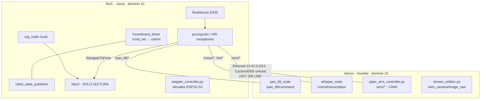

# Arquitectura Base@Home (HOME-01/02, primera pasada)

2026-10-29. Fuentes: código en `main@1da2388`, inspección en vivo de NUC y Jetson (lectura). Ver detalle en `jetson-inventory.md`, `network-topology.md`, `ros-interfaces.md`, `software-audit.md`.

## Qué corre dónde

| Host | SO / ROS | Responsabilidad (según código) | En ejecución ahora |
|---|---|---|---|
| NUC (CHUWI LarkBox S, x86-64) | Ubuntu 24.04.3, kernel 7.0, Jazzy | base hoverboard (`hoverboard_base`), Hokuyo (`urg_node`), RealSense (`realsense_nuc.launch.py`), SLAM/mapeo, **Nav2 (solo lectura)**, percepción/HRI (`base_athome_perception`, venv `~/ros2_vision_venv`), elevador (`scripts/stepper_controller.py`) | **Ningún nodo ROS ni servicio del robot** (se lanzan a mano con alias de `~/.bashrc`) — NUC_CONFIRMED |
| Jetson Orin Nano Super | Ubuntu 22.04.5, JetPack 6.2.3, Humble | pan-tilt Dynamixel, ASR Whisper, Piper por CAN, Orbbec DaBai (eye-in-hand), RealSense opcional | `jetson-head.service` en bucle de fallos (DDS sin interfaz) — JETSON_CONFIRMED |

## Flujo de arranque de la Jetson

`jetson-head.service` → `~/start_mapping_head.sh` → espera hasta 30 s IP `10.42.*` en `enP8p1s0` (continúa aunque no llegue) → `amixer` +18 dB → lanza en segundo plano `piper_arm_controller.py` y `stream_orbbec.py` → `ros2 launch robot_bringup_jetson jetson_head.launch.py enable_camera:=false enable_audio:=true language:=auto` (pan-tilt + whisper). `Restart=always` cada 5 s.

## Riesgos principales

1. Arranque automático de actuadores (Piper S-01, pan-tilt S-03) sin gate humano.
2. Enlace NUC↔Jetson caído y DDS sin fallback en la Jetson (S-02).
3. Distros ROS 2 distintas (Humble/Jazzy) en el mismo dominio (S-09).
4. Software de la Jetson fuera de Git y con deriva (S-05).
5. Perfiles HRI sintéticos indistinguibles de reales (S-04).

## Pendiente

Alimentación/BMS/fusibles (`power-domains.md`), firmware ESP32/hoverboard en detalle, TF completo en ejecución, QoS y tasas medidas (requiere sistema en marcha).
