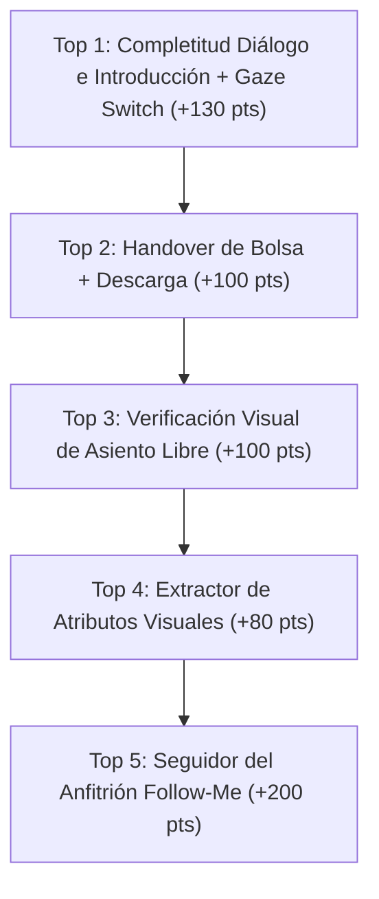

# Análisis de Brechas: HRI Challenge (RoboCup@Home 2026.2) vs. Receptionist Actual

**Documento Técnico de Auditoría y Roadmap de Implementación**  
**Fecha:** 2026-10-30  
**Autor:** Antigravity (Ingeniería de Software & HRI, Base@Home / UruBots)  
**Coordinador:** Claude Code  
**Referencia Normativa:** RoboCup@Home Rulebook — Final version for RoboCup 2026 (Revision 2026-05-11 1), Sección 5.1 "Human Robot Interaction Challenge" (págs. 35-39, líneas 1691-1916) y Reglas Generales 3.6 - 3.9 (págs. 23-27).  
**Archivos Auditados:**
- [`src/base_athome_perception/scripts/hri_receptionist_challenge.py`](file:///home/athome/orca/workspaces/base_athome_ws/antigravity-home-06a-hri-gap/src/base_athome_perception/scripts/hri_receptionist_challenge.py)
- [`src/base_athome_perception/base_athome_perception/face_recognizer.py`](file:///home/athome/orca/workspaces/base_athome_ws/antigravity-home-06a-hri-gap/src/base_athome_perception/base_athome_perception/face_recognizer.py)

---

## 1. Resumen Ejecutivo

El reglamento oficial RoboCup@Home 2026.2 introduce cambios y precisiones críticas en la prueba **5.1 Human Robot Interaction (HRI) Challenge** (anteriormente conocida como *Receptionist*). La prueba otorga un puntaje base máximo de **1450 puntos** (excluyendo penalizaciones especiales y bonus por desempeño sobresaliente), con un límite estricto de **7:00 minutos** de duración total y una regla general de **30 segundos de inactividad máxima** (Regla 3.6.14).

La auditoría del código fuente actual revela que el nodo [`hri_receptionist_challenge.py`](file:///home/athome/orca/workspaces/base_athome_ws/antigravity-home-06a-hri-gap/src/base_athome_perception/scripts/hri_receptionist_challenge.py) implementa un flujo sólido de bienvenida básica (saludo, ASR con Whisper, enrolamiento biométrico facial con SFace 128-D, navegación punto a punto con Nav2 y señalamiento de asientos mediante poses pregrabadas del brazo AgileX Piper). Sin embargo, **existen brechas sustanciales respecto al reglamento 2026.2**, destacando:
1. **Ausencia total del subsistema de bolsa y seguimiento del anfitrión (Guiding & Handover):** No existe lógica para recibir la bolsa del segundo invitado (`50 pts`), seguir al anfitrión (`200 pts`) ni soltar la bolsa (`50 pts`), lo que deja **300 puntos sin posibilidad de disputa**.
2. **Ausencia de descripción de atributos visuales del primer invitado:** El código no infiere ni menciona atributos visuales (ropa, color, accesorios), perdiendo hasta **80 puntos** de bonus (`4 × +20`).
3. **Omisión de apertura de puerta:** No se intenta la apertura autónoma de la puerta (`2 × 200 = 400 pts`), debiendo recurrir a la solicitud reglamentaria de puerta abierta por defecto.
4. **Ausencia de detección acústica de timbre:** No se detecta el timbre sonoro ni los golpes en la puerta (`2 × 30 = 60 pts`), dependiendo exclusivamente de la presencia visual del invitado.
5. **Inconsistencias en el diálogo de introducción y contacto visual:** Al presentar al segundo invitado se omite la bebida favorita del primero (`30 pts`), y el cabezal pan-tilt no alterna su orientación visual hacia cada invitado durante las presentaciones (`2 × 50 = 100 pts`).
6. **Manejo del bonus por preguntas no esenciales:** El estado `STATE_CONFIRM_DETAILS` formula una confirmación afirmativa en lugar de una pregunta, lo cual preserva el bonus normativo de **60 puntos** (`4 × 15`), pero expone al sistema a la severa penalización de **-160 puntos** (`4 × -40`) si la transcripción de Whisper comete errores de reconocimiento que no son subsanados.

---

## 2. Matriz Completa de Brechas del Score Sheet (Sección 5.1)

A continuación se detalla cada ítem del cuadro de puntuación oficial de la Sección 5.1 (líneas 1880-1916 del reglamento), correlacionado con el estado de implementación en el código actual, los riesgos técnicos y la propuesta concreta de resolución.

| # | Acción / Requisito (Reglamento 5.1) | Puntos | Estado en Código | Ubicación en Código | Riesgo Técnico / Competitivo | Propuesta Concreta de Implementación |
|---|---|:---:|:---:|---|---|---|
| **1** | **Detectar sonido de timbre** (*Detect the doorbell sound as a signal that a guest has arrived*) | $2 \times 30 = 60$ | **NO** | [`hri_receptionist_challenge.py:1028-1095`](file:///home/athome/orca/workspaces/base_athome_ws/antigravity-home-06a-hri-gap/src/base_athome_perception/scripts/hri_receptionist_challenge.py#L1028-L1095) | Pérdida directa de 60 pts. El robot no reacciona al timbre; espera pasivamente a que la persona aparezca frente a la cámara D435 o hable. | Crear nodo/hilo de escucha de audio continuo con detector espectral FFT / YAMNet o coincidencia de energía de timbre/golpes en `/voice/audio_raw` o ALSA directo, que dispare la transición de espera a aproximación/saludo inmediatamente. |
| **2** | **Abrir la puerta de entrada para el invitado** (*Open the entrance door for a guest*) | $2 \times 200 = 400$ | **NO** | [`hri_receptionist_challenge.py:1014-1027`](file:///home/athome/orca/workspaces/base_athome_ws/antigravity-home-06a-hri-gap/src/base_athome_perception/scripts/hri_receptionist_challenge.py#L1014-L1027) | Pérdida de 400 pts (28% del score total). Si se pide puerta cerrada sin tener la destreza, el robot queda bloqueado en la entrada y se agotan los 7 minutos. | **Estrategia inmediata:** Solicitar oficialmente puerta abierta por defecto al referee (línea 1715). **Medio plazo:** Primitiva de manipulación visual con Piper 6-DOF para girar picaporte y empujar hoja, condicionada a validación física con actuadores energizados. |
| **3** | **Mirar a la persona que habla al recibirla** (*Look at the person talking, when receiving a guest*) | $2 \times 50 = 100$ | **SI** (con riesgo de pérdida) | [`hri_receptionist_challenge.py:953-970`](file:///home/athome/orca/workspaces/base_athome_ws/antigravity-home-06a-hri-gap/src/base_athome_perception/scripts/hri_receptionist_challenge.py#L953-L970)<br>[`hri_receptionist_challenge.py:1038-1040`](file:///home/athome/orca/workspaces/base_athome_ws/antigravity-home-06a-hri-gap/src/base_athome_perception/scripts/hri_receptionist_challenge.py#L1038-L1040) | Si el invitado oscila lateralmente (línea 1755-1759) y el detector facial pierde el bounding box, el robot recentra la cabeza bruscamente a `(0,0)` (línea 1040), arriesgando penalización por desatención (`2 × -200 = -400 pts`, línea 1909). | Reemplazar el recentrado abrupto por un filtro de Kalman / tracking de torso con YOLOv8-pose que mantenga el seguimiento suave en el último ángulo observado durante al menos 2.5 s tras la pérdida visual. |
| **4** | **Ofrecer un asiento libre al nuevo invitado** (*Offer a free seat to the new guest*) | $2 \times 100 = 200$ | **PARCIAL** | [`hri_receptionist_challenge.py:1378-1397`](file:///home/athome/orca/workspaces/base_athome_ws/antigravity-home-06a-hri-gap/src/base_athome_perception/scripts/hri_receptionist_challenge.py#L1378-L1397) | El código ejecuta el gesto físico con el brazo Piper (`point_couch`, `point_chair`) pero **asigna el asiento a ciegas** (`guest_index - 1`). No verifica si el asiento está realmente desocupado. Si un invitado pasivo o el anfitrión se sentó allí (línea 1725, 1765), se asigna un asiento ocupado y se anulan los puntos. | Integrar `PersonPoseDetector` en la sala antes de apuntar para verificar si la bounding box del asiento en el mapa semántico contiene una pose sentada (`is_sitting`); seleccionar dinámicamente un asiento confirmado como `FREE`. |
| **5** | **Mirar en la dirección de navegación o al objetivo** (*Look in the direction of navigation or at the navigation goal*) | $2 \times 15 = 30$ | **SI** | [`hri_receptionist_challenge.py:864`](file:///home/athome/orca/workspaces/base_athome_ws/antigravity-home-06a-hri-gap/src/base_athome_perception/scripts/hri_receptionist_challenge.py#L864)<br>[`hri_receptionist_challenge.py:890-892`](file:///home/athome/orca/workspaces/base_athome_ws/antigravity-home-06a-hri-gap/src/base_athome_perception/scripts/hri_receptionist_challenge.py#L890-L892) | Bajo riesgo en navegación en línea recta. Durante rotaciones puras in-situ, el cabezal queda fijo en `base_link` en vez de orientarse hacia la tangente del path. | Alinear el pan del cabezal hacia el vector de velocidad planar $(\dot{x}, \dot{y})$ reportado por `/odom` o la pose meta del path de Nav2 si se requiere un comportamiento HRI más natural. |
| **6** | **Describir atributos visuales del primer invitado al segundo** (*Tell a visual attribute of the first guest to the second guest*) | $4 \times +20 = 80$<br>(erróneo: $4 \times -20$) | **NO** | [`hri_receptionist_challenge.py:1358-1376`](file:///home/athome/orca/workspaces/base_athome_ws/antigravity-home-06a-hri-gap/src/base_athome_perception/scripts/hri_receptionist_challenge.py#L1358-L1376)<br>[`face_recognizer.py:306-346`](file:///home/athome/orca/workspaces/base_athome_ws/antigravity-home-06a-hri-gap/src/base_athome_perception/base_athome_perception/face_recognizer.py#L306-L346) | Pérdida directa de 80 pts. Si se introducen heurísticas imprecisas y se yerra el atributo, se reciben hasta -80 pts de penalización neta. | Incorporar en `face_recognizer.py` un extractor de atributos de alta certidumbre: color dominante del torso/ropa mediante segmentación HSV del bounding box bajo el cuello, presencia de lentes o estimación de color de cabello; enunciar 2 atributos con certidumbre $>85\%$. |
| **7** | **No realizar preguntas no esenciales para confirmar/corregir** (*Not asking non-essential questions to confirm or correct information*) | $4 \times 15 = 60$ | **PARCIAL / EN REGLA** | [`hri_receptionist_challenge.py:1182-1196`](file:///home/athome/orca/workspaces/base_athome_ws/antigravity-home-06a-hri-gap/src/base_athome_perception/scripts/hri_receptionist_challenge.py#L1182-L1196) | `STATE_CONFIRM_DETAILS` no realiza preguntas cerradas de confirmación ("Did you say your name is X?"), sino una afirmación declarativa ("I noted that your favorite drink is Y"). Esto califica para los 60 pts de bonus. Sin embargo, si Whisper extrajo un dato incorrecto, la penalización es de $4 \times -40 = -160\text{ pts}$ (línea 1907). | Reestructurar el flujo: eliminar la frase redundante de `STATE_CONFIRM_DETAILS` para ganar tiempo; validar la extracción de nombre/bebida contra un diccionario léxico cerrado de nombres populares y bebidas; si la confianza ASR es menor al umbral, solicitar repetición directa ("I could not hear, please repeat") que **no computa** como pregunta no esencial (línea 1775-1776). |
| **8** | **Mencionar nombre y bebida favorita de cada invitado en la presentación** (*Say name and favorite drink of each guest during introduction*) | $4 \times 30 = 120$ | **PARCIAL** | [`hri_receptionist_challenge.py:1360-1376`](file:///home/athome/orca/workspaces/base_athome_ws/antigravity-home-06a-hri-gap/src/base_athome_perception/scripts/hri_receptionist_challenge.py#L1360-L1376) | En la presentación del segundo invitado (líneas 1369-1373), el robot menciona el nombre del primer invitado pero **omite su bebida favorita**, perdiendo 30 pts. | Modificar la plantilla de presentación en `STATE_INTRODUCE_GUESTS` para incluir formalmente ambos campos de ambos invitados: `"{guest2}, this is {guest1}, whose favorite drink is {drink1}. {guest1}, this is {guest2}, whose favorite drink is {drink2}."` |
| **9** | **Mirar al invitado correcto mientras se habla del otro invitado** (*While introducing guests, look to the correct guest while talking about the other guest*) | $2 \times 50 = 100$ | **NO** | [`hri_receptionist_challenge.py:1346-1376`](file:///home/athome/orca/workspaces/base_athome_ws/antigravity-home-06a-hri-gap/src/base_athome_perception/scripts/hri_receptionist_challenge.py#L1346-L1376) | Pérdida de 100 pts. El robot mira al frente (`0, -5`) durante todo el diálogo de presentación; no orienta el cabezal hacia el interlocutor respectivo. | Almacenar las coordenadas angulares de pan/tilt o la posición del asiento donde quedó ubicado el Invitado 1 y donde está parado el Invitado 2. Durante la locución, alternar el pan del cabezal hacia el invitado receptor del mensaje. |
| **10** | **Recibir la bolsa del segundo invitado mediante handover** (*Receive the bag from the guest via handover*) | 50<br>(asistencia: -25; en estructura: -50) | **NO** | [`hri_receptionist_challenge.py:1400-1414`](file:///home/athome/orca/workspaces/base_athome_ws/antigravity-home-06a-hri-gap/src/base_athome_perception/scripts/hri_receptionist_challenge.py#L1400-L1414) | Pérdida de 50 pts directos y bloqueo de las siguientes dos tareas (seguir y soltar = 250 pts). Total en riesgo: 300 pts. | Agregar estado `STATE_BAG_HANDOVER`: extender el brazo Piper a una pose frontal estable con pinza abierta, advertir verbalmente: *"I am ready to receive the bag. Please place the handle in my gripper. Closing in 3 seconds"*, y cerrar la pinza. |
| **11** | **Seguir al anfitrión hasta la zona de descarga de la bolsa** (*Following the host to the bag drop area*) | 200<br>(pérdidas/ayudas: -50 a -150) | **NO** | Ausente en el código | Pérdida masiva de 200 pts (segunda tarea individual más valiosa tras la puerta). | Implementar estado `STATE_FOLLOW_HOST`: solicitar verbalmente al anfitrión que se coloque frente al robot, activar nodo de seguimiento de personas (LiDAR Hokuyo + Nav2 dynamic target o tracker visual) a velocidad prudente (0.35 m/s) hasta que el anfitrión indique verbalmente la llegada. |
| **12** | **Soltar la bolsa en el área correcta** (*Drop the bag in the correct area*) | 50 | **NO** | Ausente en el código | Pérdida directa de 50 pts. | Implementar estado `STATE_DROP_BAG`: ante la orden verbal *"place the bag on the floor"*, descender el brazo Piper hacia el piso, abrir la pinza completamente (`70 mm`), confirmar visual/auditivamente la liberación y retraer a `cube_stow`. |
| **13** | **Penalización: Información incorrecta memorizada** (*Wrong guest information memorized*) | $4 \times -40 = -160$ | **RIESGO ELEVADO** | [`hri_receptionist_challenge.py:1117-1140`](file:///home/athome/orca/workspaces/base_athome_ws/antigravity-home-06a-hri-gap/src/base_athome_perception/scripts/hri_receptionist_challenge.py#L1117-L1140) | La extracción por expresiones regulares en texto crudo de Whisper es vulnerable a alucinaciones o palabras cortadas. Un solo dato falso resta 40 pts. | Implementar validación cruzada con distancia Levenshtein sobre nombres populares en inglés (listados en el benchmark de RoboCup) y matching estricto de bebidas. |
| **14** | **Penalización: HRI alternativo** (*Alternative HRI*) | $6 \times -20 = -120$ | **BAJO RIESGO** | [`hri_receptionist_challenge.py:693-700`](file:///home/athome/orca/workspaces/base_athome_ws/antigravity-home-06a-hri-gap/src/base_athome_perception/scripts/hri_receptionist_challenge.py#L693-L700) | La interfaz por teclado `[T]` solo se activa si se presiona la tecla manualmente. El nodo usa Whisper ASR por defecto. | Mantener los atajos de teclado exclusivamente para depuración en laboratorio y deshabilitar o ignorar entradas manuales en modo de competencia oficial. |
| **15** | **Penalización: No atender o ignorar personas** (*Not acknowledging people*) | $2 \times -200 = -400$ | **RIESGO MEDIO** | [`hri_receptionist_challenge.py:1040`](file:///home/athome/orca/workspaces/base_athome_ws/antigravity-home-06a-hri-gap/src/base_athome_perception/scripts/hri_receptionist_challenge.py#L1040)<br>[`hri_receptionist_challenge.py:1346-1376`](file:///home/athome/orca/workspaces/base_athome_ws/antigravity-home-06a-hri-gap/src/base_athome_perception/scripts/hri_receptionist_challenge.py#L1346-L1376) | Si el robot no orienta su mirada hacia un invitado que le habla o mira hacia una dirección no relacionada durante la interacción, el árbitro aplica -200 pts por invitado. | Garantizar que el pan-tilt siempre responda con rotación suave hacia la fuente visual/sonora del interlocutor y nunca se congele en una dirección irrelevante. |
| **16** | **Tiempo límite total e inactividad** (Reglas 3.6.14 y 5.1) | Descalificación / 0 pts restantes | **PARCIAL** | [`hri_receptionist_challenge.py:1092`](file:///home/athome/orca/workspaces/base_athome_ws/antigravity-home-06a-hri-gap/src/base_athome_perception/scripts/hri_receptionist_challenge.py#L1092)<br>[`hri_receptionist_challenge.py:1149`](file:///home/athome/orca/workspaces/base_athome_ws/antigravity-home-06a-hri-gap/src/base_athome_perception/scripts/hri_receptionist_challenge.py#L1149) | **Límite 7:00 min:** No hay temporizador global en el código; locuciones excesivas y esperas pueden exceder el tiempo reglamentario. **Inactividad 30s:** Los timeouts de 20s en puerta y 10s en audio evitan la descalificación, pero no hay watchdog general. | Implementar watchdog general con cuenta regresiva de 7 min; acortar textos de síntesis de voz (`Piper TTS`) para que cada ciclo de invitado no demore más de 180 segundos. |

---

## 3. Análisis Técnico Detallado de Brechas Clave

### 3.1. Detección de Timbre vs. Entrada Espontánea (Reglamento líneas 1730-1731, 1747-1752)
- **Regla:** Se reproduce un sonido de timbre tradicional (o golpes en la puerta) cuando el invitado está listo. Para obtener los **60 puntos** ($2 \times 30$), el robot debe estar esperando en la posición de inicio y **reaccionar de manera instantánea** al sonido. La regla permite explícitamente el bypass (ir directamente a la puerta sin esperar timbre), pero en ese caso se renuncia a los puntos.
- **Estado Actual:** En [`hri_receptionist_challenge.py:1042-1073`](file:///home/athome/orca/workspaces/base_athome_ws/antigravity-home-06a-hri-gap/src/base_athome_perception/scripts/hri_receptionist_challenge.py#L1042-L1073), el estado `STATE_WAIT_DOOR` solo reacciona ante la detección de rostro ($\ge 500\text{ px}^2$), presencia de silueta con YOLOv8-pose o palabras de saludo en Whisper. No existe procesamiento espectral ni detector de eventos acústicos (AED).
- **Impacto:** Pérdida limpia de 60 puntos. Si el robot está en la posición inicial del salón y no escucha el timbre, no sabrá cuándo desplazarse a la puerta.

### 3.2. Apertura Autónoma de Puerta (Reglamento líneas 1702, 1715-1716, 1739-1740)
- **Regla:** Por defecto, la puerta de entrada permanece abierta. El líder de equipo puede solicitar que esté cerrada para que el robot gane **400 puntos** ($2 \times 200$) abriéndola autónomamente.
- **Estado Actual:** El robot navega hasta la puerta (`STATE_NAV_TO_DOOR`) y espera la aparición del invitado. No posee ninguna rutina de detección visual del picaporte, aproximación de precisión, manipulación de cerrojo ni accionamiento de la hoja de la puerta.
- **Riesgo:** Alto riesgo de falla catastrófica si se solicita puerta cerrada sin tener un pipeline cinemático y de control de impedancia/fuerza validado en hardware real. Un atasco en la puerta provocaría la pérdida de la totalidad de la prueba (inactividad $>30\text{ s}$ o agotamiento de los 7 min).
- **Recomendación Estratégica:** Notificar en la reunión de capitanes que la puerta permanezca **abierta por defecto**. Esto asegura 0 puntos en ese ítem pero elimina el riesgo de descalificación o colisión, permitiendo concentrarse en los restantes 1050 puntos del desafío.

### 3.3. Dinámica de Diálogo, Bonus por No Confirmar y Penalización por Datos Erróneos
- **Regla (líneas 1704-1705, 1772-1776, 1892, 1907):**
  - Si el robot no formula preguntas no esenciales para confirmar o corregir información (ej. *"Did you say your name is James?"* o *"Is your favorite drink milk?"*), se le otorgan **60 puntos de bonus** ($4 \times 15$).
  - Las solicitudes de repetición por falta de inteligibilidad (*"I could not hear you, please repeat"*) **no se consideran preguntas no esenciales**.
  - Si el robot memoriza o anuncia un dato erróneo, sufre una penalización de **-160 puntos** ($4 \times -40$).
- **Estado Actual en Código:**
  - En [`hri_receptionist_challenge.py:1182-1185`](file:///home/athome/orca/workspaces/base_athome_ws/antigravity-home-06a-hri-gap/src/base_athome_perception/scripts/hri_receptionist_challenge.py#L1182-L1185), el estado `STATE_CONFIRM_DETAILS` dice:
    ```python
    confirm_msg = f"Thank you, {self.current_name}! I noted that your favorite drink is {self.current_drink}."
    self.say(confirm_msg, emotion="happy", blocking=True)
    ```
  - Esto es una **declaración afirmativa**, no una pregunta; técnicamente preserva el bonus de 60 puntos.
  - Sin embargo, si Whisper transcribió erróneamente un fonema (ej. *"David"* en lugar de *"Charlie"*, o *"Beer"* por *"Water"*), el robot asume el dato como verídico y continúa sin corregirlo, incurriendo en la penalización de -40 puntos por dato (hasta -160 pts).
- **Propuesta:**
  1. Suprimir la locución de `STATE_CONFIRM_DETAILS` o fusionarla directamente con la transición a memorización facial, ahorrando ~4 segundos por invitado.
  2. Implementar un filtro fonético / Levenshtein con un umbral de confianza probabilístico. Si la certeza es baja, usar la excepción permitida por el reglamento: *"I did not hear clearly, could you please repeat your name and drink?"*, sin incurrir en penalización de confirmación no esencial.

### 3.4. Descripción Visual del Primer Invitado (Reglamento líneas 1703, 1741-1743, 1889-1891)
- **Regla:** Al presentar a los invitados, el robot debe describir hasta 4 atributos visuales del primer invitado al segundo invitado. Cada atributo correcto suma **+20 puntos** ($4 \times +20 = 80\text{ pts}$); cada atributo incorrecto resta **-20 puntos** ($4 \times -20 = -80\text{ pts}$).
- **Estado Actual:** [`face_recognizer.py`](file:///home/athome/orca/workspaces/base_athome_ws/antigravity-home-06a-hri-gap/src/base_athome_perception/base_athome_perception/face_recognizer.py) extrae exclusivamente el embedding biométrico facial SFace de 128 dimensiones para identificación métrica. No computa atributos semánticos. En [`hri_receptionist_challenge.py:1368-1373`](file:///home/athome/orca/workspaces/base_athome_ws/antigravity-home-06a-hri-gap/src/base_athome_perception/scripts/hri_receptionist_challenge.py#L1368-L1373), el texto de presentación omite completamente cualquier descripción visual.
- **Propuesta:** Incorporar un módulo de extracción de atributos durante el enrolamiento del Invitado 1:
  - Color de vestimenta superior (recorte del 50% inferior del bounding box facial expandido hacia el torso, analizado en espacio HSV/K-Means para obtener colores canónicos: red, blue, green, black, white, yellow).
  - Presencia de lentes (análisis de textura o subred CNN sobre la región ocular).
  - Color de cabello (muestreo en la región superior a la frente).
  - Formular la descripción con cautela: reportar solo los 2 o 3 atributos que superen un umbral de confianza del 85% para evitar penalizaciones negativas.

### 3.5. Presentación Mutua y Mirada Dinámica (Reglamento líneas 1741-1743, 1766-1771, 1894-1895)
- **Regla:**
  - El robot debe decir el nombre y bebida favorita de **cada invitado** (4 ítems $\times 30 = 120\text{ pts}$).
  - Mientras habla de un invitado, debe **mirar al otro invitado** ($2 \times 50 = 100\text{ pts}$).
- **Estado Actual:**
  - En la línea 1370 de [`hri_receptionist_challenge.py`](file:///home/athome/orca/workspaces/base_athome_ws/antigravity-home-06a-hri-gap/src/base_athome_perception/scripts/hri_receptionist_challenge.py#L1370):
    `"Charlie, {first_guest['name']}, this is our new guest, {self.current_name}. Their favorite drink is {self.current_drink}."`
    Se menciona el nombre del Invitado 1, pero se omite su bebida favorita.
  - El cabezal se mantiene fijo en el centro durante la locución (líneas 1358-1375).
- **Propuesta:** Dividir la presentación en dos actos con control síncrono del cabezal pan-tilt:
  1. Mirar al Invitado 2: *"{Guest 2}, this is {Guest 1}, and their favorite drink is {Drink 1}."*
  2. Girar el cabezal hacia el Invitado 1: *"{Guest 1}, this is {Guest 2}, and their favorite drink is {Drink 2}."*

### 3.6. Detección de Asientos Libres vs. Ocupados (Reglamento líneas 1723, 1740, 1763-1765, 1887)
- **Regla:** El robot debe ofrecer un **asiento libre** a cada nuevo invitado ($2 \times 100 = 200\text{ pts}$). La regla advierte que puede haber invitados pasivos sentados y que los invitados pueden cambiarse de lugar.
- **Estado Actual:** [`hri_receptionist_challenge.py:1381`](file:///home/athome/orca/workspaces/base_athome_ws/antigravity-home-06a-hri-gap/src/base_athome_perception/scripts/hri_receptionist_challenge.py#L1381) toma ciegamente el índice del invitado para asignar `couch` o `chair`. Si un humano ya está sentado en el sofá, el robot lo invitará a sentarse encima, perdiendo los 100 puntos.
- **Propuesta:** En `STATE_FIND_HOST` / `STATE_DETECT_AND_OFFER_SEAT`, realizar un barrido con el cabezal pan-tilt y consultar `PersonPoseDetector` sobre los ROIs de los asientos definidos en `semantic_map.yaml`. Clasificar cada asiento como `OCCUPIED` si hay keypoints de caderas/rodillas en el área, y seleccionar el primer asiento en estado `FREE`.

### 3.7. Handover de Bolsa, Seguimiento del Anfitrión y Descarga (Reglamento líneas 1743-1746, 1777-1784, 1814-1826, 1897-1905)
- **Regla:** El segundo invitado trae una bolsa. El robot debe:
  1. Recibir la bolsa mediante handover en su pinza (`50 pts`). Si el robot pide ayuda se restan 25 pts; si pide ponerla en su estructura, 0 pts. El brazo debe mantenerse quieto y positioned within 10 cm, anunciando: *"Closing gripper in 3 seconds"*.
  2. Comunicar al anfitrión que tiene la bolsa y pedirle que lo guíe.
  3. Seguir al anfitrión caminando naturalmente por la casa (`200 pts`).
  4. Ante la orden del anfitrión, soltar la bolsa en el suelo (`50 pts`).
- **Estado Actual:** Esta fase está **completamente ausente** en el código. Al terminar con el segundo invitado, el sistema salta a `STATE_CHALLENGE_COMPLETE` (línea 1412).
- **Propuesta de Arquitectura:**
  - Agregar estados: `STATE_BAG_HANDOVER`, `STATE_PROMPT_HOST_GUIDE`, `STATE_FOLLOW_HOST`, `STATE_DROP_BAG`.
  - Diseñar una pose segura de brazo `bag_handover_ready` y `bag_carry_stow`.
  - Conectar el seguimiento dinámico utilizando la posición de la persona provista por el sensor LiDAR/RealSense conectada al action server de Nav2.

### 3.8. Restricciones de Tiempo: Límite de 7:00 Minutos e Inactividad de 30 Segundos
- **Regla (3.6.14 y 5.1):** Límite máximo inapelable de 7:00 minutos. Inactividad $>30\text{ s}$ provoca descalificación inmediata de la prueba.
- **Estado Actual:** Las esperas activas con `pump_gui` y los recordatorios verbales (línea 1092 a los 20s, línea 1149 a los 10s) cumplen de forma defensiva con la regla de inactividad de 30 segundos. Sin embargo, no existe control de tiempo global; las locuciones extensas en `Piper TTS` (ej. 1010, 1015, 1099, 1143, 1184, 1187, 1340, 1348, 1361, 1389, 1401) junto a las 4 navegaciones entre puerta y sala insumen entre 5 y 6 minutos, dejando un margen sumamente estrecho para la nueva fase de handover y seguimiento de anfitrión.

---

## 4. Top-5 de Mejoras Prioritarias por Relación Puntos / Esfuerzo (ROI Técnico)

Para maximizar el puntaje en la competencia oficial optimizando los recursos de desarrollo y evitando riesgos mecánicos prematuros, se establece el siguiente orden prioritario:



### 1. Corrección Integral de la Presentación Mutua y Mirada Cruzada (+130 Puntos | Esfuerzo: Muy Bajo)
- **Impacto:** **+130 pts** (+30 pts por incluir la bebida del primer invitado + 100 pts por alternar la mirada entre ambos invitados durante la presentación) y eliminación del riesgo de penalización por desatención (-200 pts).
- **Archivos a Modificar:** [`src/base_athome_perception/scripts/hri_receptionist_challenge.py:1358-1376`](file:///home/athome/orca/workspaces/base_athome_ws/antigravity-home-06a-hri-gap/src/base_athome_perception/scripts/hri_receptionist_challenge.py#L1358-L1376).
- **Acción:**
  1. Enmendar la frase para enunciar nombre y bebida de ambos: `"{G2}, this is {G1}, favorite drink {D1}. {G1}, this is {G2}, favorite drink {D2}."`
  2. Insertar `self.move_head_to(pan_g2, tilt)` antes de hablarle a G2, y `self.move_head_to(pan_g1, tilt)` al dirigirse a G1.

### 2. Handover de Bolsa y Descarga Autónoma en el Suelo (+100 Puntos | Esfuerzo: Bajo / Medio)
- **Impacto:** **+100 pts** (+50 pts recepción de bolsa + 50 pts soltar la bolsa en el área designada).
- **Archivos a Modificar:** [`src/base_athome_perception/scripts/hri_receptionist_challenge.py`](file:///home/athome/orca/workspaces/base_athome_ws/antigravity-home-06a-hri-gap/src/base_athome_perception/scripts/hri_receptionist_challenge.py) (nuevos estados `STATE_BAG_HANDOVER` y `STATE_DROP_BAG`).
- **Acción:**
  1. Definir dos poses articulares precalibradas en `ARM_GESTURE_POSES`: `bag_receive` (antebrazo horizontal, pinza abierta a 70 mm) y `bag_drop` (antebrazo apuntando al suelo).
  2. Implementar la secuencia verbal reglamentaria: *"Please place the bag in my gripper. Closing in 3 seconds"* $\rightarrow$ cierre de pinza $\rightarrow$ transporte seguro $\rightarrow$ apertura en zona de descarga.

### 3. Verificación de Ocupación Real de Asientos con YOLOv8-Pose (+100 Puntos | Esfuerzo: Bajo)
- **Impacto:** Asegura los **+200 pts** de asignación de asiento libre (evitando la anulación de 100 pts por asignar un sofá o silla ocupada por invitados pasivos).
- **Archivos a Modificar:** [`src/base_athome_perception/scripts/hri_receptionist_challenge.py:1378-1397`](file:///home/athome/orca/workspaces/base_athome_ws/antigravity-home-06a-hri-gap/src/base_athome_perception/scripts/hri_receptionist_challenge.py#L1378-L1397).
- **Acción:**
  1. Utilizar `self.pose_detector` (ya integrado en línea 287) al entrar a la sala para filtrar qué asientos de `semantic_map.yaml` contienen keypoints de personas sentadas.
  2. Ofrecer y apuntar dinámicamente con el brazo Piper únicamente al asiento que esté libre.

### 4. Extracción de Atributos Visuales del Primer Invitado (+80 Puntos | Esfuerzo: Medio)
- **Impacto:** **+80 pts** ($4 \times +20$) de bonus al describir visualmente al primer invitado.
- **Archivos a Modificar:** [`src/base_athome_perception/base_athome_perception/face_recognizer.py`](file:///home/athome/orca/workspaces/base_athome_ws/antigravity-home-06a-hri-gap/src/base_athome_perception/base_athome_perception/face_recognizer.py) y [`hri_receptionist_challenge.py`](file:///home/athome/orca/workspaces/base_athome_ws/antigravity-home-06a-hri-gap/src/base_athome_perception/scripts/hri_receptionist_challenge.py).
- **Acción:**
  1. Desarrollar un método `extract_visual_attributes(image, bbox)` que recorte el torso bajo la cabeza y compute el color dominante de la ropa y la presencia de anteojos.
  2. Guardar estos atributos en el perfil `PersonProfile.attributes` del Invitado 1 y verbalizarlos en la presentación al Invitado 2 (*"Charlie, {G2}, this is {G1}. He is wearing a dark shirt and glasses"*).

### 5. Habilidad de Seguimiento al Anfitrión (*Follow-Me*) (+200 Puntos | Esfuerzo: Alto)
- **Impacto:** **+200 pts** por completar el guiado del anfitrión hasta el área de descarga de la bolsa.
- **Archivos a Modificar:** Paquete de navegación / nuevo nodo de seguimiento y estado `STATE_FOLLOW_HOST`.
- **Acción:**
  1. Suscribirse a la detección de la persona anfitrión (`Charlie`) o tracking láser de piernas con el LiDAR Hokuyo UST-05LX.
  2. Enviar comandos continuos de velocidad a `/cmd_vel` o waypoints dinámicos a Nav2 manteniendo una distancia de seguimiento de 1.0 m sin requerir paradas ni contacto físico.

---

## 5. Hoja de Ruta y Próximos Pasos

1. **Fase 1 (Inmediata - Offline en Software):**
   - Modificar las plantillas de diálogo e introducir el cambio alternado de mirada en `STATE_INTRODUCE_GUESTS` ([`hri_receptionist_challenge.py`](file:///home/athome/orca/workspaces/base_athome_ws/antigravity-home-06a-hri-gap/src/base_athome_perception/scripts/hri_receptionist_challenge.py)).
   - Implementar el clasificador de color de ropa en [`face_recognizer.py`](file:///home/athome/orca/workspaces/base_athome_ws/antigravity-home-06a-hri-gap/src/base_athome_perception/base_athome_perception/face_recognizer.py) con tests unitarios offline.
   - Añadir la máquina de estados para recepción y entrega de bolsa (`STATE_BAG_HANDOVER` y `STATE_DROP_BAG`).
2. **Fase 2 (Validación con Sensores Activos):**
   - Probar la detección de asientos libres con `PersonPoseDetector` en la NUC utilizando la cámara RealSense D435.
   - Ajustar el umbral y filtro fonético de ASR Whisper para proteger el bonus de no confirmación sin caer en penalizaciones por información memorizada errónea.
3. **Fase 3 (Integración de Actuadores y Puesta en Marcha):**
   - Calibrar físicamente las poses del brazo AgileX Piper para recibir y soltar la bolsa de tela estándar anunciada por el comité organizador (OC).
   - Validar la integración del seguimiento dinámico de anfitrión con la base móvil en el entorno del laboratorio.
