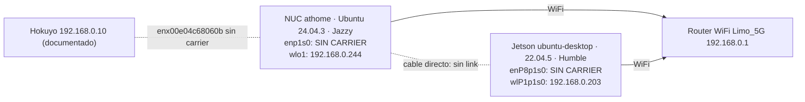

# Topología de red NUC ↔ Jetson (HOME-01E)

Medido 2026-10-29 ~23:40 (-03), comandos de lectura (`ip`, `nmcli`, `ping`, `ssh`). No se modificó ninguna configuración de red.

## Estado actual (2026-10-30 09:56, `ETHERNET_CONFIRMED`)

**Enlace activo** por el adaptador USB de la Jetson, no por su puerto integrado:

| Host | Interfaz | Estado |
|---|---|---|
| NUC | `enp1s0` (PCI) | UP, carrier 1, 1000 Mb/s full, `10.42.0.1/24` (NM shared) |
| Jetson | `enx00e04c68090c` (USB RTL8153, driver `r8152`, bus USB 3 5 Gb/s) | UP, 1000 Mb/s full, `10.42.0.12/24`, 0 rx_errors |
| Jetson | `enP8p1s0` (integrado) | sigue **sin carrier** → puerto o cable de ese lado sospechoso |

- Ping 0 % pérdida, RTT 0.19–0.27 ms. Throughput (cota inferior, `dd` por SSH aes128-gcm): 300 MB en 3.65 s ≈ 82 MB/s (~660 Mb/s). `iperf3` no instalado.
- Reloj: desfase NUC↔Jetson −11.9 ms (NTP sobre SSH, RTT 0.2 ms). Aceptable (< 50 ms), vigilar.
- `scripts/net/check_nuc_jetson_link.sh`: **8 OK, 0 FAIL** (`log/net_checks/20261030_095609.txt`); ahora autodetecta la interfaz de la Jetson que tiene `10.42.0.12`.
- Alguien actualizó en la Jetson (09:39–09:40) `~/cyclonedds.xml` para ligar por `address="10.42.0.12"` y `~/start_mapping_head.sh` para esperar cualquier interfaz con `10.42.x`. Copia de referencia: `jetson_head/config/cyclonedds_jetson.xml`; el repo incorpora ese cambio más el fallback solo-localhost (no desplegado).

## Histórico 2026-10-29 (sin enlace)

**El enlace Ethernet directo NO estaba activo.** Ninguno de los dos extremos detecta portadora:

| Host | Interfaz | Estado | Config | Evidencia |
|---|---|---|---|---|
| NUC `athome` | `enp1s0` (PCI) | `NO-CARRIER`, `carrier=0` | NM "Wired connection 1", `ipv4.method=shared` (sería `10.42.0.1`) | NUC_CONFIRMED |
| NUC | `enx00e04c68060b` (USB RTL) | `NO-CARRIER` | NM "Wired connection 2", manual `192.168.0.14/29` (red del Hokuyo, documentado `192.168.0.10`) | NUC_CONFIRMED |
| NUC | `wlo1` | UP `192.168.0.244/24` (`Limo_5G`) | default route | NUC_CONFIRMED |
| Jetson `ubuntu-desktop` | `enP8p1s0` | DOWN, sin IP | esperado `10.42.0.12` vía DHCP de la NUC | JETSON_CONFIRMED |
| Jetson | `enx00e04c68090c` (USB RTL8153) | DOWN | — | JETSON_CONFIRMED |
| Jetson | `wlP1p1s0` | UP `192.168.0.203/24` | default route | JETSON_CONFIRMED |

`ping 10.42.0.12`: 100 % pérdida. `ping 192.168.0.203` (WiFi): OK, RTT 234–355 ms (alto y variable; no apto para DDS de cámaras).

Diagnóstico probable: cable desconectado/dañado o conectado a otro puerto. Como el carrier falta en **ambos** lados, no es un problema de IP/DHCP. **Acción humana:** revisar el cable físico entre `enp1s0` de la NUC y `enP8p1s0` de la Jetson; con link, NM debería levantar `10.42.0.1/24` en modo shared y la Jetson obtener `10.42.0.12`.

## Configuración DDS

| | NUC | Jetson |
|---|---|---|
| `ROS_DOMAIN_ID` | 10 | 10 |
| RMW | `rmw_cyclonedds_cpp` | `rmw_cyclonedds_cpp` |
| `CYCLONEDDS_URI` en esta sesión | `~/cyclonedds_local.xml` (autodetect, multicast). `~/.bashrc` usa `~/cyclonedds.xml` solo si `/sys/class/net/enp1s0/carrier` = 1 | `~/cyclonedds.xml` |
| `cyclonedds.xml` Ethernet | interfaz `enp1s0`, `multicast=false`, peers `10.42.0.1`, `10.42.0.12` | interfaz `enP8p1s0`, `multicast=false`, mismos peers |

Consecuencia: la Jetson **no tiene ese fallback**; con su configuración, si `enP8p1s0` no existe/está sin link, **ningún nodo ROS 2 puede arrancar** (falla al crear el dominio). Es un punto único de fallo; ver `software-audit.md` S-02.

## Pruebas ROS 2 inter-host

2026-10-30: dominio 77 (sintético) OK en ambos sentidos Humble↔Jazzy. Dominio 10, solo lectura desde la NUC: `ros2 topic list/hz/echo` funcionan; tasas en `ros-interfaces.md`.

**Incompatibilidad Humble↔Jazzy confirmada:** `ros2 node list` desde la NUC devuelve vacío y, al aparecer un participante Jazzy, los nodos Humble registran `invalid data size` / `string data is not null-terminated` (`serdata.cpp:384`). Es el tópico interno `ros_discovery_info` (`rmw_dds_common`), cuyo formato cambió entre distros. Los tópicos de usuario con mensajes idénticos sí funcionan. Impacto: herramientas de introspección por nodo (node list/info, parámetros remotos) no fiables entre hosts hasta migrar la Jetson a Jazzy (HOME-11).

Histórico (2026-10-29): `BLOCKED`: sin enlace Ethernet. No se hicieron pruebas DDS por WiFi para no publicar en el dominio 10 ni modificar `cyclonedds.xml`. Además Humble ↔ Jazzy no garantiza interoperabilidad de mensajes; validar tras la migración con un dominio de prueba (≠10) y un `std_msgs/String` sintético, según `RED_ETHERNET.md` §4.
