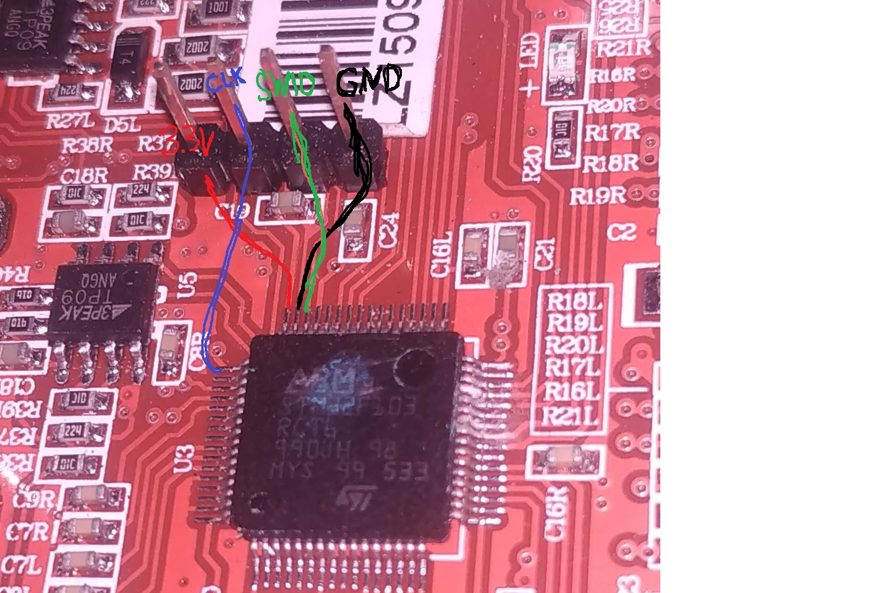

# Hoverboard Motherboards: Pinouts, Cableado y Programación

Esta guía detalla los esquemas de conexión, pinouts de programación SWD y cableado serial (UART) para las distintas variantes de placas base de hoverboard soportadas en este repositorio.

---

## 1. Placa Roja "Lenzod" (STM32F103RCT6)

La placa roja comercializada bajo la marca **Lenzod** utiliza un microcontrolador STM32F103RCT6 de alta densidad (256 KB Flash, 64 KB SRAM).



### 1.1 Header de Programación SWD (4 pines)
> [!CAUTION]
> **El orden de pines en la placa Lenzod está INVERTIDO respecto a las placas genéricas.**
> Si miras la placa de frente con el chip STM32 abajo y la hilera de 4 pines arriba (a la izquierda del capacitor grande):

| Pin (Izq -> Der) | Señal ST-Link | Función | Advertencia |
| :---: | :---: | :---: | :--- |
| **Pin 1 (Extremo Izq)** | `3.3V` / VCC | Alimentación 3.3V | ⚠️ **NUNCA conectar este pin si la batería principal (36V) está conectada o la placa está encendida.** Provocará cortocircuito y quemará el ST-Link. |
| **Pin 2** | `SWCLK` | Clock de depuración SWD | Conectar a pin SWCLK del ST-Link |
| **Pin 3** | `SWDIO` | Datos de depuración SWD | Conectar a pin SWDIO del ST-Link |
| **Pin 4 (Extremo Der)** | `GND` | Tierra / Referencia | Conectar a GND del ST-Link |

#### Procedimiento Seguro de Flasheo:
1. Conectar **GND**, **SWCLK** y **SWDIO** entre el ST-Link V2 y la placa. Dejar el cable de 3.3V completamente desconectado.
2. Encender la placa normalmente con su botón de encendido (alimentada con su batería de 36V).
3. Conectar el ST-Link a la PC vía USB.
4. Flashear con `st-flash`:
   ```bash
   st-flash write firmware_bin/hover_lenzod_usart3_odometry.bin 0x08000000
   ```

### 1.2 Conexión Serial FTDI (Cable Sensor Derecho - USART3)
Para teleoperación y comunicación con ROS 2, la placa Lenzod utiliza el **cable derecho (USART3)**:

| Cable Placa Lenzod | Señal Hoverboard | Pin Conversor FTDI / USB-TTL |
| :---: | :---: | :---: |
| **Verde** | `TX` (PB10) | **RXD** |
| **Azul** | `RX` (PB11) | **TXD** |
| **Negro** | `GND` | **GND** |
| **Rojo** | `15V` / VCC | ⛔ **NO CONECTAR** (Quema el conversor) |

Baudrate configurado: **115200 bps**, 8N1.

---

## 2. Placa Genérica STM32F103 (Haitai Tech / Split Board)

Las placas verdes clásicas (ej. Haitai Tech 2016) suelen usar el layout estándar del proyecto original *hoverboard-firmware-hack-FOC*.

### 2.1 Header SWD Estándar (4 pines)
| Pin (1 -> 4) | Señal ST-Link | Notas |
| :---: | :---: | :--- |
| **Pin 1** | `GND` | Tierra común |
| **Pin 2** | `SWCLK` | Clock SWD |
| **Pin 3** | `SWDIO` | Datos SWD |
| **Pin 4** | `3.3V` | Solo conectar si NO está conectada la batería |

### 2.2 Variantes de Puerto Serial UART:
- **Opción A (Cable Izquierdo - USART2):** `PA2` (TX), `PA3` (RX). Usar preset `firmware_config/generic_stm32_usart2/config.h`.
- **Opción B (Cable Derecho - USART3):** `PB10` (TX), `PB11` (RX). Usar preset `firmware_config/generic_stm32_usart3/config.h`.

---

## 3. Protocolo de Telemetría Serial (22 Bytes con Odometría)

Cuando `#define ENABLE_ODOMETRY` está activo, la placa transmite un paquete binario a 100 Hz / 50 Hz con el siguiente formato (`SerialFeedback`):

| Campo | Tipo | Tamaño | Descripción |
| :---: | :---: | :---: | :--- |
| `start` | `uint16_t` | 2 bytes | Cabecera fija `0xABCD` (Little-endian: `0xCD 0xAB`) |
| `cmd1` | `int16_t` | 2 bytes | Steer comandado recibido |
| `cmd2` | `int16_t` | 2 bytes | Speed comandado recibido |
| `speedR_meas` | `int16_t` | 2 bytes | RPM / velocidad rueda derecha |
| `speedL_meas` | `int16_t` | 2 bytes | RPM / velocidad rueda izquierda |
| `wheelR_cnt` | `int16_t` | 2 bytes | Pulsos de odometría encoder Hall rueda derecha |
| `wheelL_cnt` | `int16_t` | 2 bytes | Pulsos de odometría encoder Hall rueda izquierda |
| `batVoltage` | `uint16_t` | 2 bytes | Voltaje batería en centivoltios (ej. 3850 = 38.50V) |
| `boardTemp` | `uint16_t` | 2 bytes | Temperatura en décimas de grado (ej. 250 = 25.0°C) |
| `cmdLed` | `uint16_t` | 2 bytes | Estado de LEDs / errores |
| `checksum` | `uint16_t` | 2 bytes | XOR de todos los campos anteriores con máscara `0xFFFF` |
| **Total** | | **22 bytes** | |

Los paquetes de comando enviados a la placa (`SerialCommand`) tienen un tamaño de **8 bytes**:
- `start` (`0xABCD`) + `steer` (`int16_t`) + `speed` (`int16_t`) + `checksum` (`uint16_t`).
