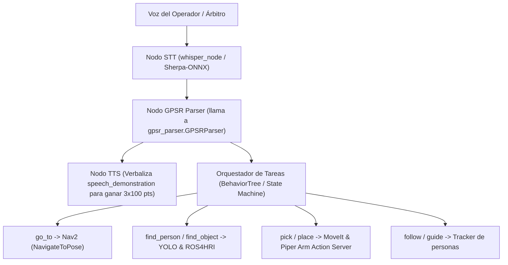

# GPSR Parser Offline — Base@Home / UruBots

Parser determinista offline de comandos de voz en lenguaje natural para la prueba **GPSR (General Purpose Service Robot)** de RoboCup@Home (§5.3), convirtiendo texto libre o comandos re-frasados en un plan JSON estructurado con vocabulario cerrado de acciones, junto con la frase en inglés para la demostración en voz alta del robot.

---

## 1. Contexto de Competencia (RoboCup@Home §5.3)

En la prueba GPSR, el árbitro u operador emite 3 órdenes generadas mediante el [CommandGenerator oficial](https://github.com/RoboCupAtHome/CommandGenerator) y re-frasadas sucesivamente (hasta 3 veces, en lenguaje cada vez más simple y directo):
- **Entender el comando:** 3 × 80 pts = 240 pts.
- **Demostrar que se generó un plan:** 3 × 100 pts = 300 pts (el robot verbaliza su plan de acción antes de ejecutarlo).

Este parser está diseñado para ejecutarse **100% offline**, sin dependencia de modelos de lenguaje en la nube (cero latencia de red, cero costo de API y cero riesgo de desconexión en arena de competencia).

---

## 2. Vocabulario Cerrado de Acciones

El parser genera planes compuestos exclusivamente por las siguientes acciones atómicas estándar:

| Acción | Parámetros | Descripción |
|---|---|---|
| `go_to` | `location: str` | Navegar hacia una ubicación o habitación de la arena |
| `find_object` | `object: str` o `category: str` | Localizar un objeto o clase de objeto mediante visión |
| `pick` | `object: str` | Tomar / manipular un objeto con el brazo robótico |
| `place` | `location: str` | Depositar el objeto en una superficie o contenedor |
| `deliver_to` | `person: str` o `location: str` | Entregar el objeto al operador ("me"), persona o lugar |
| `find_person` | `name`, `gesture`, `posture`, `clothing` | Localizar una persona según su nombre o atributos visuales |
| `follow` | `person: str`, `destination?: str` | Seguir a una persona (opcionalmente hasta un destino) |
| `guide` | `person: str`, `location: str` | Guiar / escoltar a una persona a una ubicación |
| `say` | `text: str` | Decir una frase o dato requerido (hora, día, equipo, etc.) |
| `answer_question` | `{}` | Escuchar y responder una pregunta del operador |
| `count` | `target: str`, `location: str`, filtros... | Contar personas u objetos en una ubicación |
| `describe` | `target: str`, `property: str`, `location: str` | Identificar atributos (objeto más grande/pesado, etc.) |

---

## 3. Instalación y Entorno

Requiere **Python 3.12**. Las dependencias están pineadas en `requirements.txt`.

### Configuración del Virtualenv
```bash
cd tools/gpsr_parser
python3.12 -m venv .venv
source .venv/bin/activate
pip install -r requirements.txt
```

### Datos de Competencia (CompetitionTemplate)
El parser carga dinámicamente nombres, habitaciones, locaciones y objetos desde archivos Markdown compatibles con [RoboCupAtHome/CompetitionTemplate](https://github.com/RoboCupAtHome/CompetitionTemplate):
- `data/names/names.md`
- `data/maps/room_names.md`
- `data/maps/location_names.md`
- `data/objects/objects.md`

> **Nota sobre licencias y gitignore:** La carpeta `tools/gpsr_parser/data/` está ignorada en `.gitignore` para no versionar datos de terceros sin licencia explícita. Para clonar o actualizar los datos:
> ```bash
> git clone https://github.com/RoboCupAtHome/CompetitionTemplate.git /tmp/rc_template
> cp -r /tmp/rc_template/{names,maps,objects} tools/gpsr_parser/data/
> ```

---

## 4. Uso por Línea de Comandos (CLI)

Ejecución directa como módulo Python:

```bash
cd tools/gpsr_parser
.venv/bin/python -m gpsr_parser "bring me a coke from the kitchen"
```

### Salida generada:
```text
=== GPSR PLAN ===
Command: "bring me a coke from the kitchen"
Success: True

Plan JSON:
[
  {
    "action": "go_to",
    "params": {
      "location": "kitchen"
    }
  },
  {
    "action": "find_object",
    "params": {
      "object": "cola"
    }
  },
  {
    "action": "pick",
    "params": {
      "object": "cola"
    }
  },
  {
    "action": "deliver_to",
    "params": {
      "person": "me"
    }
  }
]

Robot Speech Demonstration (HRI):
"I will go to the kitchen, find the cola, pick up the cola, and deliver it to you."
```

### Opciones del CLI:
- `--json-only`: Imprime únicamente el objeto JSON del plan (ideal para pipes o scripts).
- `-d` / `--data-dir`: Especifica una ruta personalizada a la carpeta de datos de competencia.

---

## 5. Generación del Dataset Oficial y Métricas

El dataset de prueba se genera con el generador oficial de RoboCup@Home:

```bash
cd tools/gpsr_parser
.venv/bin/python scripts/make_dataset.py -n 500 -o data/commands.jsonl
```

### Ejecución de Pruebas Automatizadas
```bash
cd tools/gpsr_parser
.venv/bin/python -m pytest -v -s
```

### Métricas de Rendimiento Obtenidas:
- **Total de comandos evaluados:** 500 comandos generados con `CommandGenerator` oficial.
- **Comandos parseados sin error (`success == True`):** **500 / 500 (100.00%)**
- **Validez de la primera acción:** **500 / 500 (100.00%)**
- **Casos re-frasados simples manuales:** **24 / 24 (100.00%)**
- **Garantía de cero excepciones:** Verificado ante entradas vacías, caracteres especiales, bytes nulos y texto basura; siempre devuelve un `PlanResult` con error estructurado.
- **Tiempo de ejecución de suite completa:** **~0.10 segundos** (ultrarrápido, ~0.2 ms por comando).

---

## 6. Limitaciones Conocidas

1. **Entidades dinámicas:** Los nombres de personas, objetos, muebles y habitaciones se resuelven contra la base de datos de la competencia (`data/`). Nuevos objetos o locaciones no declarados en los archivos Markdown requieren agregarse al archivo correspondiente o al diccionario de sinónimos.
2. **Sinónimos coloquiales:** Incluye mapeos estándar (`coke` $\to$ `cola`, `fridge` $\to$ `refrigerator`, `trash` $\to$ `trashbin`, etc.). Variaciones dialectales no previstas requerirán enriquecer el diccionario de normalización.
3. **Cláusulas coordinadas complejas:** Oraciones compuestas por múltiples `and` se resuelven asumiendo ejecución secuencial de búsqueda y manipulación.

---

## 7. Diseño de Integración Futura como Nodo ROS 2

*(Solo descripción de arquitectura; ningún nodo ROS fue creado en este módulo).*

Cuando se proceda a la fase de integración en ROS 2 Jazzy, el parser podrá envolverse dentro de un paquete dedicado (por ejemplo, `base_athome_gpsr` o `base_athome_task_planning`):

### Interfaces ROS 2 Propuestas:
- **Servicio `ParseGPSRCommand.srv`:**
  ```text
  string command
  ---
  bool success
  string plan_json
  string speech_demonstration
  string error
  ```
- **Action `ExecuteGPSRPlan.action`:**
  ```text
  string plan_json
  ---
  bool success
  string error
  ---
  uint32 current_action_index
  string current_action_name
  ```

### Flujo Operativo en Base@Home:


## Revisión del coordinador (Claude Code, 2026-10-30)

- La métrica "primera acción válida 100 %" solo verifica que la acción pertenezca al vocabulario cerrado; **no mide corrección del plan**.
- Pruebas manuales con fallas (HOME-15b):
  - `go to the bedroom, find Angel and follow them` → solo `follow(them)`: se pierden `go_to(bedroom)` y `find_person(Angel)`.
  - `could you please fetch the apple that is on the dining table and give it to Robin in the office` → falta `go_to(dining table)`, `find_object(apple)`, `pick(apple)`.
  - `salute the person raising their left arm ...` → no genera la acción de saludo (`say`).
- Correctos en la muestra: `bring me a coke from the kitchen`, `tell me how many people in the living room are wearing red shirts`.
- Siguiente paso: dataset con planes esperados (del CommandGenerator, que conoce la estructura) y métrica de plan exacto.
